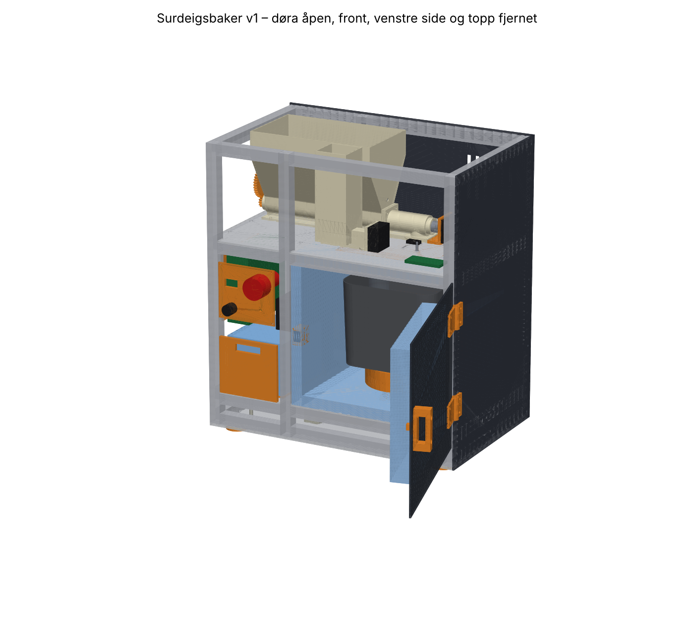

# Surdeigsbaker 🍞

**En åpen DIY-maskin på kjøkkenbenken som lager surdeigsdeigen for deg: levain, dosering, elting og bulkheving med bretting, til deigen er klar for forming når du vil. Du former, lar den kaldheve i ditt eget kjøleskap og steker i din vanlige ovn.**

> **Status (oktober 2026): Prototype v1 er designet og klar til bygging** ([ADR-010](docs/beslutninger/ADR-010-v1-arkitektur.md)). Ingenting er bygget ennå. [`hardware/v1/`](hardware/v1/README.md) har STL-filer, kappefiler, stykkliste, koblingsskjema og byggeveiledning, og [`firmware/v1/`](firmware/v1/README.md) har fastvaren, testet i simulering. Det første designet (v0) bygges ikke. Følg med, eller bidra!

## Hvorfor?

Et godt surdeigsbrød krever få ingredienser, men mange små håndgrep på riktig tidspunkt over et døgn: mating, autolyse, elting, bretting, forming, heving og kald heving. Tidene endrer seg med årstiden. *Selve stekingen* tar under en time og fungerer utmerket i en vanlig ovn med jerngryte. Det tidkrevende er alt som skjer før. Brødmaskiner kan elte, men de bretter ikke, måler ikke hevingen og sier ikke fra når deigen er klar for forming. **Det nærmeste vi har funnet, er produkter som bare steller surdeigen.** Vi vil lage maskinen for resten, og vi gjør det åpent.

## Målet

> **Suksess:** En ferdig prototype på kjøkkenbenken som har laget deigen til sine første surdeigsbrød, stekt i vanlig ovn. Kriteriene er:
> - tre godkjente brød på rad, med ≥ 80 % av referansebrødets poengsum
> - deigen klar for forming til planlagt tid (±30 min)
> - minimalt med manuelt arbeid
> - bestått sikkerhetssjekkliste

| Nivå | Maskinen gjør | Du gjør (i tillegg til å steke) |
|---|---|---|
| N1 | Smart hevekabinett: varme, tidsplan og varsler | Blander, elter, bretter og former |
| N2 (v0, bygges ikke) | Blander, elter, bulkhever med bretting og varsler når deigen er klar for forming | Veier og heller i ingrediensene, former og setter kurven i kjøleskapet |
| **N3 (v1, bygges nå)** | Doserer mel, vann og salt, bygger levain og gjør alt det andre, og treffer tiden du velger | Tilsetter 1–2 ss surdeig, fyller på beholdere og former |
| N4 (strekkmål) | Steller i tillegg surdeigen («Surhild-modulen») | Fyller på og vasker ukentlig |

**Overlevering:** Maskinen sier fra: *«Deigen er klar for forming.»* Du former den på 2–5 min, legger den i hevekurven og setter den i kjøleskapet til neste dag. Maskinen har ingen kjøling.

Detaljer: [`docs/00-visjon-og-suksesskriterier.md`](docs/00-visjon-og-suksesskriterier.md), [ADR-006](docs/beslutninger/ADR-006-steking-i-vanlig-ovn.md) og [ADR-007](docs/beslutninger/ADR-007-ingen-kjoling.md).

## v1: maskinen som bygges



Du legger 1–2 ss surdeig i formen, velger når deigen skal være klar for forming, og trykker **Start**. Maskinen veier surdeigen, planlegger baklengs, bygger levainen, lager deigen, bretter, måler hevingen og varsler deg når deigen er klar.

- **481 × 306 × 526 mm:** ramme av 2020-profil med plater, isolert kammer med dør, tårn og beholdere på toppen
- **Brødmaskinform fra Panasonic XL** (fra en brukt maskin) med eget drivverk: 24 V girmotor og reim
- **Vekt under hele drivverket** (én lastcelle). Maskinen veier surdeigen og alt den doserer.
- **Doserer selv:** mel med skrue og røreverk, salt med en liten skrue og vann med en peristaltisk pumpe. Saltlaken lages i formen.
- **Tidsplanlegger** som lærer hvor aktiv surdeigen din er, og justerer varmen for å treffe tiden
- **Bare 24 V** fra en CE-merket strømforsyning. Dørbryter og nødstopp bryter motoren i maskinvaren.
- **ESP32-S3 med ESPHome**, ToF-sensor, IR-termometer, kamera (Pi Zero 2 W), nettside, Home Assistant og varsler på mobilen
- **Ca. 17 800 kr** i deler og ca. 1,2 kg PETG

Alt er generert fra én parameterfil med Python-koden i [`hardware/cad/v1/`](hardware/cad/README.md). Endrer du et mål, får du nye filer og en ny [sjekkrapport](hardware/v1/sjekkrapport.md) på et par minutter. Bakeprogrammet er testet med hele simulerte bakedager. **[Byggeveiledning →](hardware/v1/README.md)**

## Veikart

| Fase | Innhold | Port / milepæl | Status |
|---|---|---|---|
| 0 | Oppstart, forstudie og referansebrød | G0: kravspesifikasjon v1 | 🟡 pågår |
| 1 | Prosesseksperimenter og fermenteringsmodell | G1: maskinvennlig oppskrift | ⚪ |
| 2–3 | ~~Bygg v0~~ og konseptvalg for v1: hoppet over, v1 designet direkte ([ADR-010](docs/beslutninger/ADR-010-v1-arkitektur.md)) | G3: ADR-001 avgjort | ✅ design klart |
| 4 | **Bygg og test prototype v1:** E11 melskrue, E17 elting, kalibrering av modellen | **M4: I MÅL 🎉** | 🟡 klar til bygging |
| 5 | Dokumentasjon og DIY-klargjøring | G5: noen andre bygger en | ⚪ |

Detaljer, tidslinje og risikoregister: [`docs/04-veikart.md`](docs/04-veikart.md)

## Dokumentasjon

| Dokument | Innhold |
|---|---|
| [00 – Visjon og suksesskriterier](docs/00-visjon-og-suksesskriterier.md) | Mål, automasjonsnivåer, brødkort, rammer og designprinsipper |
| [01 – Prosessanalyse](docs/01-prosessanalyse.md) | Fra håndgrep til maskinfunksjoner, og den maskinvennlige hypotesen |
| [02 – Forskningsplan](docs/02-forskningsplan.md) | Forskningsspørsmål, forskningsområdene FO1–FO8 og foreløpige funn |
| [03 – Konsepter](docs/03-konsepter.md) | Fire konsepter, en Pugh-matrise og valget av konsept |
| [04 – Veikart](docs/04-veikart.md) | Faser, porter, risikoer og arbeidsform |
| [05 – Eksperimenter](docs/05-eksperimenter.md) | E01–E18 |
| [06 – Sikkerhet](docs/06-sikkerhet.md) | Elektrisk sikkerhet, brannsikkerhet, matkontakt og regelverk ⚠️ |
| [07 – Arkitektur](docs/07-arkitektur.md) | Moduler, sensorer, effekt, termikk, styring og programvare |
| [08 – Kilder](docs/08-kilder.md) | Leseliste og kjente løsninger |
| [09 – Budsjett og innkjøp](docs/09-budsjett-og-innkjop.md) | Handleliste per fase |
| [10 – Verktøykjede](docs/10-verktoykjede.md) | Åpne CAD-, EDA-, simulerings- og fastvareverktøy for AI-agenter (MCP), med sikkerhetssperrer |
| [11 – Bruksscenarier](docs/11-bruksscenarier.md) | En bakedag med v0 og med v1: hva du gjør, og hva maskinen gjør |
| [Beslutninger (ADR)](docs/beslutninger/) | Viktige valg og begrunnelser |
| [Referanseoppskrift](oppskrifter/referanse-v7.md) | Gullstandarden, oversatt til prosessparametre |
| [**Byggeveiledning v1**](hardware/v1/README.md) | Hva du skal måle, kjøpe, printe, kappe og montere, og hvordan du setter maskinen i drift |
| [Koblingsskjema v1](hardware/v1/koblingsskjema.md) | 24 V-fordeling, sikkerhetskjede, pinnekart og kablene over veiespalten |
| [Fastvare v1](firmware/v1/README.md) | Bakeprogrammet, testene, simuleringen og første opplasting |
| [v0](hardware/v0/README.md) | Det første designet, beholdt som referanse |

## Struktur

```text
docs/           plan, forskning, beslutninger og maler
oppskrifter/    referanseoppskrift og maskinlesbare oppskrifter (.yaml)
data/           bakelogger og rådata fra eksperimenter
hardware/spec/  parameterfila som alle mål leses fra
hardware/cad/   build123d-kode (v1/ lager alt i hardware/v1/)
hardware/v1/    STL, STEP, DXF, stykkliste, koblingsskjema, bilder og byggeveiledning
firmware/v1/    ESPHome-fastvare med bakeprogram i C++, tester og simulering
hardware/v0/, firmware/v0/   det første designet (referanse, bygges ikke)
```

## Bidra

Alle bidrag er velkomne: bakelogger, eksperimenter, kilder, ideer og etter hvert kode og maskinvare. Se [`CONTRIBUTING.md`](CONTRIBUTING.md). Bruk issue-malene for **bakelogg**, **eksperiment** og **idé**.

## ⚠️ Sikkerhet

v1 har bare 24 V inne i maskinen (fra en CE-merket strømforsyning), men den har en sterk motor, skruer og et varmeelement, og den skal kunne gå ubemannet i mange timer. Les [`docs/06-sikkerhet.md`](docs/06-sikkerhet.md) før du bygger noe. Du bygger og bruker den på eget ansvar.

## Lisens

Dokumentasjonen er lisensiert under CC BY-SA 4.0, maskinvaren under CERN-OHL-S-2.0 og programvaren under GPL-3.0-or-later. Se [`LICENSE.md`](LICENSE.md). Lisensvalget er foreløpig ([ADR-003](docs/beslutninger/ADR-003-sprak-og-lisens.md)).

---

### English summary

**Surdeigsbaker** ("sourdough baker") is an open-source DIY countertop machine for everything *before* shaping: levain, mixing, kneading and temperature-controlled bulk fermentation with folds and rise measurement. It tells you when the **dough is ready for shaping**, at the time you choose. You shape it, cold-retard it in your own fridge and bake it in your regular oven. Documentation is in Norwegian for now.

**Prototype v1 is designed and ready to build** ([`hardware/v1/`](hardware/v1/README.md)): you put 1–2 tablespoons of starter in the pan and choose when the dough should be ready. The machine weighs the starter, plans backwards, builds the levain, doses flour, water and salt by weight (flour screw with agitator, salt screw, peristaltic pump), kneads in a Panasonic bread-machine pan driven by its own 24 V gearmotor, folds, measures the rise and learns how active your starter is. The whole drive sits on one load cell. 24 V only (external CE-marked supply) with hardware door and e-stop interlocks, ESP32-S3 with ESPHome. Everything is generated from one parameter file by parametric build123d code with automatic design checks, and the bake program is C++ tested with simulated whole-day bakes. The bill of materials is about NOK 17,800. Nothing has been built yet.

Contributions and bake logs are welcome. Licences: CC BY-SA 4.0 for docs, CERN-OHL-S-2.0 for hardware, GPL-3.0-or-later for software.
