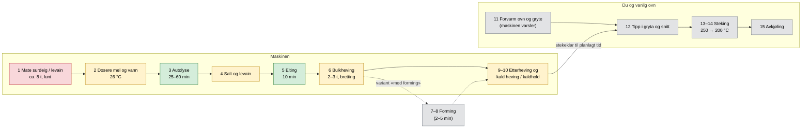

# 01 – Prosessanalyse: fra håndgrep til maskinfunksjoner

Her brytes referanseoppskriften ([`oppskrifter/referanse-v7.md`](../oppskrifter/referanse-v7.md)) ned i **maskinfunksjoner**. For hver funksjon vurderer vi hvor vanskelig den er å automatisere og hvilke løsninger som finnes. Til slutt foreslår vi en *maskinvennlig prosess*, som er en hypotese som eksperimentene skal teste.

**Avgrensning ([ADR-006](beslutninger/ADR-006-steking-i-vanlig-ovn.md)):** Maskinen slutter ved ovnsdøra. Steking og avkjøling (trinn 11–15) gjøres av mennesket i vanlig ovn.

## Prosessflyt

Fargene viser hvor vanskelig hvert trinn er å automatisere: grønn er lett, gul middels og rød vanskelig. Grå trinn gjøres av mennesket.



## Funksjonsanalyse

| # | Manuelt steg | Maskinfunksjon | Krav (utkast) | Vanskelighet | Kandidatløsninger | Kan forenkles? |
|---|---|---|---|---|---|---|
| 1 | Mate surdeig | Kassere, dosere mel og vann, røre, holde temperatur, oppdage når surdeigen er klar | ±2 g, 24–28 °C ±0,5 °C | **Høy** (klissent, hygiene, mugg) | Bygge levain direkte i bollen, peristaltisk pumpe for flytende surdeig, ToF-sensor for heving, modell for tid og temperatur | **Ja:** Med levain i bollen tilsetter mennesket bare 1 ss surdeig (N3) |
| 2 | Veie mel og vann | Dosere og veie, temperere vannet | Mel ±1 %, vann ±1 %, vann 26 ±1 °C | Middels | Lastceller under bollen (én vekt for alt), skrue- eller sneglemater for mel, peristaltisk pumpe eller magnetventil for vann | Nei, men på N2 gjør mennesket det |
| 3 | Autolyse | Vente og holde temperatur | 25–60 min | Lav | Temperaturstyrt kammer | Kanskje. Kan bli «fermentolyse» med levain fra start (E04). |
| 4 | Salt og levain | Dosere salt, blande inn levain | Salt ±0,5 g | Middels | **Salt som saltlake** dosert med pumpe (bassinage-prinsippet), vibrasjonsmater eller liten snegle | **Ja:** Saltlake gjør tørrstoffdosering om til væskedosering |
| 5 | Elting | Motor med krok eller padle | ca. 10 min, lav hastighet, ca. 1 kg deig | Lav | Brødmaskinpadle, spiralkrok, motor fra kjøkkenmaskin | – |
| 6 | Bulkheving med strekk og brett | Holde temperatur, bearbeide deigen med jevne mellomrom, måle heving | 24–27 °C, bretting hver 30. min, +20–25 % volum | Middels | Korte og langsomme krokomdreininger, ToF-sensor eller kamera for heving | **Ja:** Bretting kan kanskje erstattes av mer elting eller korte omrøringer (E05) |
| 7–8 | Forforming og endelig forming | Gi overflatespenning og stram form | – | **Svært høy** for maskin, **2–5 min** for menneske | Ingen forming der gryta er formen, eller at mennesket former når maskinen varsler | **Ja:** Variant «uten forming» (E06), eller manuell forming |
| 9–10 | Etterheving, kald heving og kaldhold | Holde temperatur med både varme og kjøling, holde deigen kald til stekeklar tid | Rom: 2 t. Kaldt: 4–6 °C i opptil 24 t, kaldhold ≥ 12 t | Middels | Kompressor (ombygd vinkjøleskap) eller Peltier, isolert kammer | **Ja:** Kald bulkheving i bollen (E09) |
| 11 | Forvarme ovn og gryte | **Utenfor maskinen.** Maskinen *varsler* i god tid. | Varsel 45–60 min før stekeklar tid | Lav | Varsel på mobil, valgfri integrasjon med smartovn | – |
| 12 | Overlevering og snitting | **Mennesket** tipper kald deig fra bolle eller kurv i varm gryte og snitter | Uten å punktere deigen | Lav for menneske | Avtakbar bolle eller hevekurv med slippbelegg. Kald deig er lett å snitte. | Kanskje sømsiden opp (E07) |
| 13–15 | Steking og avkjøling | **Utenfor maskinen**, i vanlig ovn | Som referansen | – | – | – |
| – | Rengjøring | – | Mindre enn 5 min per brød | **Høy** | Avtakbare deler som tåler oppvaskmaskin, slippbelegg | Designes inn fra start |

## Hypotese: en maskinvennlig prosess (v0)

Eksperimentene i fase 1 skal bekrefte eller avkrefte denne hypotesen ([`05-eksperimenter.md`](05-eksperimenter.md)):

> **H0:** Et brød laget med prosessen under og stekt som referansen får ≥ 80 % av poengsummen til referansebrødet.

| Trinn | Referanse (v7.0) | Maskinvennlig v0 | Testes i |
|---|---|---|---|
| Levain | Separat glass, flytetest | I bollen. Mennesket tilsetter 1 ss surdeig. Ferdig etter modell (tid og temperatur), senere med sensor. | E02, E03 |
| Autolyse | Mel og vann først, deretter salt og levain | Fermentolyse: alt unntatt salt, deretter saltlake | E04 |
| Bretting | Hver 30. min for hånd | 3–4 korte og langsomme omrøringer med kroken | E05 |
| Forming | Forforming, benkhvile og endelig forming | **A:** Ingen («tipp og stek»). **B:** Mennesket former når maskinen varsler. | E06 |
| Etterheving | 2 t i kurv, så kjøleskap | **A:** Kald bulkheving i bollen. **B:** Etterheving og kald heving i kurv i maskinens kammer. | E09 |
| Kaldhold | Opptil 24 t i kjøleskap | Maskinen holder 4–6 °C til du er klar, og varsler | E16 |
| Overlevering | Fra kurv til varm gryte | Mennesket tipper kald deig fra bolle (A) eller kurv (B) i varm gryte | E10 |
| Snitting | Kniv eller barberblad | Mennesket snitter, eller sømsiden opp | E07 |
| Steking | 260 °C forvarming, 250 °C med lokk, 200 °C uten | **Uendret**, i vanlig ovn | (E08) |

Hvis H0 holder med variant A, trenger maskinen verken forming eller avansert håndtering av deig. Variant B er en sikker reserveplan som gir referansekvalitet med to korte manuelle grep.

## Tidsplanlegging bakover («stekeklar kl. 07:00»)

Med styrt temperatur blir tiden for hvert trinn forutsigbar. Maskinen kan da regne baklengs fra ønsket tidspunkt:

```text
stekeklar 07:00  →  varsel «forvarm ovnen» ca. 06:00–06:15
     ↑
[kald heving / kaldhold: buffer på 8–20 t, absorberer usikkerhet]
     ↑
(variant B: varsel «form deigen nå» ved slutten av bulk, ofte om kvelden)
     ↑
bulkheving (modell: f(temperatur, levain-andel))
     ↑
elting / fermentolyse  ←  levain (modell: f(temperatur, forhold))  ←  start
```

Den kalde hevingen fungerer som en **buffer**. Usikkerhet i surdeigens aktivitet (± 1–2 t) tas opp der, i stedet for å forskyve tidspunktet. Kaldholdet etterpå gjør at du ikke må steke på minuttet. Deigen kan vente kald i flere timer (E16). Fermenteringsmodellen lages fra dataene i E02.

Variant B krever at mennesket er tilgjengelig når bulkhevingen er ferdig. Tidsplanleggeren skal derfor kunne legge formevarselet til et ønsket tidsrom (f.eks. 19–22) ved å justere starttid og temperatur.
