# 01 – Prosessanalyse: fra håndgrep til maskinfunksjoner

Her brytes referanseoppskriften ([`oppskrifter/referanse-v7.md`](../oppskrifter/referanse-v7.md)) ned i **maskinfunksjoner**. For hver funksjon vurderer vi hvor vanskelig den er å automatisere og hvilke løsninger som finnes. Til slutt foreslår vi en *maskinvennlig prosess*, som er en hypotese som eksperimentene skal teste.

## Prosessflyt

Fargene viser hvor vanskelig hvert trinn er å automatisere: grønn er lett, gul middels og rød vanskelig.

```mermaid
flowchart LR
  A["1 Mate surdeig<br/>ca. 8 t, lunt"]:::hard --> B["2 Dosere mel og vann<br/>26 °C"]:::mid
  B --> C["3 Autolyse<br/>25–60 min"]:::easy
  C --> D["4 Salt og levain"]:::mid
  D --> E["5 Elting<br/>10 min"]:::easy
  E --> F["6 Bulkheving<br/>2–3 t, bretting"]:::mid
  F --> G["7–8 Forming"]:::hard
  G --> H["9–10 Etterheving og<br/>kald heving"]:::mid
  H --> I["12 Overføring<br/>og snitting"]:::hard
  I --> J["11/13–14 Steking<br/>250 → 200 °C"]:::mid
  J --> K["15 Avkjøling"]:::easy
  classDef easy fill:#d4edda,stroke:#2e7d32,color:#000
  classDef mid fill:#fff3cd,stroke:#b8860b,color:#000
  classDef hard fill:#f8d7da,stroke:#b71c1c,color:#000
```



## Funksjonsanalyse

| # | Manuelt steg | Maskinfunksjon | Krav (utkast) | Vanskelighet | Kandidatløsninger | Kan forenkles? |
|---|---|---|---|---|---|---|
| 1 | Mate surdeig | Kassere, dosere mel og vann, røre, holde temperatur, oppdage når surdeigen er klar | ±2 g, 24–28 °C ±0,5 °C | **Høy** (klissent, hygiene, mugg) | Bygge levain direkte i bollen, peristaltisk pumpe for flytende surdeig, ToF-sensor for heving, CO₂-sensor, modell for tid og temperatur | **Ja:** Med levain i bollen tilsetter mennesket bare 1 ss surdeig (N3) |
| 2 | Veie mel og vann | Dosere og veie, varme vannet | Mel ±1 %, vann ±1 %, vann 26 ±1 °C | Middels | Lastceller under bollen (én vekt for alt), skrue- eller sneglemater for mel, peristaltisk pumpe eller magnetventil for vann | Nei, men på N2 gjør mennesket det |
| 3 | Autolyse | Vente og holde temperatur | 25–60 min | Lav | Temperaturstyrt kammer | Kanskje. Kan bli «fermentolyse» med levain fra start (E04). |
| 4 | Salt og levain | Dosere salt, blande inn levain | Salt ±0,5 g | Middels | **Salt som saltlake** dosert med pumpe (bassinage-prinsippet), vibrasjonsmater eller liten snegle | **Ja:** Saltlake gjør tørrstoffdosering om til væskedosering |
| 5 | Elting | Motor med krok eller padle | ca. 10 min, lav hastighet, ca. 1 kg deig | Lav | Brødmaskinpadle, spiralkrok, motor fra kjøkkenmaskin | – |
| 6 | Bulkheving med strekk og brett | Holde temperatur, bearbeide deigen med jevne mellomrom, måle heving | 24–27 °C, bretting hver 30. min, +20–25 % volum | Middels | Korte og langsomme krokomdreininger, ToF-sensor eller kamera for heving | **Ja:** Bretting kan kanskje erstattes av mer elting eller korte omrøringer (E05) |
| 7–8 | Forforming og endelig forming | Gi overflatespenning og stram form | – | **Svært høy** | Ingen forming der gryta er formen, konisk «rounder», forming ved tipping | **Ja:** Uten forming, som i no-knead-metoden (E06) |
| 9–10 | Etterheving og kald heving | Holde temperatur, både varme og kjøling | Rom: 2 t. Kaldt: 4–6 °C i opptil 24 t | Middels til høy | Peltier eller kompressor, isolert kammer, kald *bulk*heving i bollen i stedet for i kurv | **Ja:** Kald bulkheving i bollen, der det ikke er ovnsvarme (E09) |
| 11 | Forvarme gryte | Varme en lukket gryte til 260 °C | ca. 2 kW, ≤ 45 min | Middels | Bordovn med gryte, «elektrisk jerngryte» med egne elementer | Kanskje. Kaldstart kan fjerne behovet (E08). |
| 12 | Overføre og snitte | Flytte deig fra bolle eller kurv til varm gryte og kutte overflaten | Uten å punktere deigen | **Høy** | Vippbar bolle, luke eller slippbunn, bakepapir som «slynge», heve direkte i stekebeholderen, sømsiden opp i stedet for snitting | **Ja:** Én enkel overføring og ingen snitting (E07, E10) |
| 13–14 | Steking | Styre temperaturen, ta av lokket | 20 min ved 250 °C med lokk, 25 min ved 200 °C uten | Middels | Motorisert lokk eller dampventil, PID-styring | – |
| 15 | Avkjøling og varsling | Få brødet ut på rist, varsle | Innen ca. 5 min | Middels | Varsel på mobil (v1), vippegryte (senere) | **Ja:** På v1 tar mennesket ut brødet |
| – | Rengjøring | – | Mindre enn 5 min per brød | **Høy** | Avtakbare deler som tåler oppvaskmaskin, slippbelegg | Designes inn fra start |

## Hypotese: en maskinvennlig prosess (v0)

Eksperimentene i fase 1 skal bekrefte eller avkrefte denne hypotesen ([`05-eksperimenter.md`](05-eksperimenter.md)):

> **H0:** Et brød bakt med prosessen under får ≥ 70 % av poengsummen til referansebrødet.

| Trinn | Referanse (v7.0) | Maskinvennlig v0 | Testes i |
|---|---|---|---|
| Levain | Separat glass, flytetest | I bollen. Mennesket tilsetter 1 ss surdeig. Ferdig etter modell (tid og temperatur), senere med sensor. | E02, E03 |
| Autolyse | Mel og vann først, deretter salt og levain | Fermentolyse: alt unntatt salt, deretter saltlake | E04 |
| Bretting | Hver 30. min for hånd | 3–4 korte og langsomme omrøringer med kroken | E05 |
| Forming | Forforming, benkhvile og endelig forming | Ingen. Deigen tippes fra bollen, og gryta gir formen. | E06 |
| Etterheving | 2 t i kurv, så kjøleskap | Kald bulkheving i bollen, kort varm etterheving i gryta | E09 |
| Overføring | Fra kurv til varm gryte | Fra bolle til varm gryte (C) eller til kald gryte (D) | E08, E10 |
| Snitting | Kniv eller barberblad | Ingen. Sømsiden opp gir naturlig oppbrudd. | E07 |
| Steking | 260 °C forvarming, 250 °C med lokk, 200 °C uten | Samme profil (C) eller kaldstartprofil (D) | E08 |

Hvis H0 holder, faller de tre røde trinnene (forming, snitting og avansert overføring) bort fra v1. Da blir maskinen *mye* enklere å bygge. Hvis H0 ikke holder, viser eksperimentene hvilket trinn som må automatiseres, og det blir den største tekniske risikoen i prosjektet.

## Tidsplanlegging bakover («ferdig kl. 07:00»)

Med styrt temperatur blir tiden for hvert trinn forutsigbar. Maskinen kan da regne baklengs fra ønsket ferdigtid:

```text
ferdig 07:00  ← avkjøling 1 t ← steking 45 min ← forvarming 45 min
              ← [kald heving: buffer på 8–20 t, absorberer usikkerhet]
              ← bulkheving (modell: f(temperatur, levain-andel))
              ← elting/autolyse ← levain (modell: f(temperatur, forhold))
              ← start
```

Den kalde hevingen fungerer som en **buffer**. Usikkerhet i surdeigens aktivitet (± 1–2 t) tas opp der, i stedet for å forskyve ferdigtiden. Fermenteringsmodellen lages fra dataene i E02.
