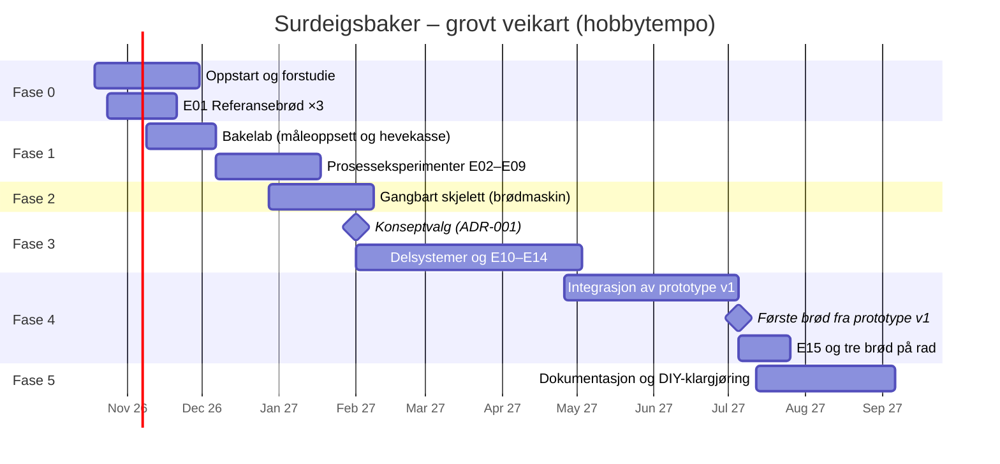

# 04 – Veikart: fra idé til første brød

Planen går i seks faser. Hver fase avsluttes med en **port** (G0–G5): et sett med kriterier som må være oppfylt før neste fase starter for fullt. Fasene overlapper med vilje. Eksperimentene i én fase gir data til designet i den neste.

Tidsanslagene forutsetter **hobbytempo, ca. 6–10 timer i uka**, og er grove. De justeres ved hver port.

## Fase 0 – Oppstart og forstudie (uke 1–6)

**Mål:** Forstå feltet, etablere referansen og fryse kravene.

- [ ] Opprett repoet, GitHub-prosjekttavle og etiketter (`eksperiment`, `bakelogg`, `research`, `hardware`, `firmware`, `sikkerhet`)
- [ ] **E01:** Bak referansebrødet tre ganger med full logg, og gjør skjeemål om til gram
- [ ] Forstudie FO1–FO8 etter [forskningsplanen](02-forskningsplan.md), med et kort kunnskapsnotat (1–3 sider) per område
- [ ] Analyser kjente løsninger og søk i patenter (FO2)
- [ ] Mål kjøkkenbenken (plass under overskap, plassering av stikkontakt og hvilken sikringskurs den har)
- [ ] Velg plattform for måleoppsettet i fase 1 (ADR-002, se [arkitektur](07-arkitektur.md))
- [ ] Sett opp verktøykjeden for agentstyrt design ([`10-verktoykjede.md`](10-verktoykjede.md), ADR-005). Installer de låste versjonene, legg inn CI-sjekker og test sikkerhetssperrene i `.claude/settings.json`.
- [ ] Innfør en månedlig rutine for å skanne nye verktøy og MCP-servere
- [ ] Bestill deler til fase 1 ([handleliste](09-budsjett-og-innkjop.md))

**Port G0:** Kravspesifikasjon v1 er frosset (oppdatert [`00-visjon-og-suksesskriterier.md`](00-visjon-og-suksesskriterier.md)), E01 er fullført og alle kunnskapsnotatene er skrevet.

## Fase 1 – Bakelab og maskinvennlig oppskrift (uke 4–12)

**Mål:** Finne ut hvilke håndgrep maskinen *ikke* trenger å gjøre, og lage en fermenteringsmodell.

- [ ] Bygg måleoppsettet: ESP32 med temperaturfølere, ToF-sensor, lastcelle og logging til dashboard eller CSV. ESPHome-oppsettet valideres og kompileres i CI og testes i Wokwi før et menneske flasher det.
- [ ] Bygg en hevekasse med varme og kjøling (isolert kasse, varmeelement og Peltier). Den er både et eksperimentkammer og en tidlig prototype av surdeigs- og hevemodulen.
- [ ] Kjør E02 og E03 (surdeigskinetikk og «klar»-signal)
- [ ] Kjør E04–E09 (forenklinger av prosessen og stekemetode) med kjøkkenmaskin og vanlig ovn
- [ ] Lag fermenteringsmodell v1 og maskinvennlig oppskrift v1 ([`oppskrifter/maskinvennlig-v0.yaml`](../oppskrifter/maskinvennlig-v0.yaml))

**Port G1:** H0 er bekreftet eller avkreftet. Det betyr at vi vet om forming og snitting må med i v1, og at det er valgt mellom kald bulkheving og kald etterheving. Modellen treffer innenfor ±1 t.

## Fase 2 – Gangbart skjelett: hacket brødmaskin (uke 10–16) *(valgfritt, anbefalt)*

**Mål:** Få hele programvarekjeden (oppskrift, styring, sikkerhet, logging og varsling) til å fungere på ekte maskinvare, og få det første maskinbakte surdeigsbrødet.

- [ ] Kjøp en brukt brødmaskin (Finn.no). Demonter, dokumenter og mål motor, element og føler (en «teardown»).
- [ ] Erstatt styringen: mikrokontroller, SSR og relé, nye temperaturfølere og en **uavhengig termosikring i serie med elementet**
- [ ] Implementer sikkerhetsvakten, oppskriftsmotoren (tilstandsmaskin) og loggingen, se [arkitektur](07-arkitektur.md)
- [ ] Kjør den maskinvennlige oppskriften som formbrød, etter manuell veiing (N2)
- [ ] Gjør feilinjeksjon som en «mini-E15»

**Port G2 / milepæl M2:** 🍞 *Første maskinbakte surdeigsbrød* (formbrød, N2). Sikkerhetsarkitekturen er verifisert ved at termosikringen er testet og løser ut.

> Hopper du over fase 2, flyttes leveransene for programvare og sikkerhet til fase 3.

## Fase 3 – Konseptvalg og delsystemer (uke 15–28)

**Mål:** Velge konsept og få hvert delsystem til å oppfylle spesifikasjonen sin hver for seg.

- [ ] **ADR-001: Konseptvalg** (Pugh-matrise oppdatert med data fra E05–E09, se [konsepter](03-konsepter.md))
- [ ] Elte- og hevemodul: bolle, krok og motor, temperaturstyring med varme og kjøling, lastceller (E13 og E14)
- [ ] Overføring: vippemekanisme og bollebelegg (**E10, gjøres først**: den største risikoen)
- [ ] Stekemodul: gryte, varmeelementer, isolasjon og motorisert lokk (E08 og E13)
- [ ] Dosering (for N3): snegle for mel, pumpe for vann og saltlake (E11 og E12)
- [ ] Mekanisk konsept i CAD (build123d og FreeCAD) og elektrisk skjema (KiCad 10, med separat 230 V-kort og lavspenningskort), se [verktøykjeden](10-verktoykjede.md)

**Port G3:** Alle delsystemene har bestått testene sine. CAD-modellen av hele maskinen viser at den får plass innenfor rammene.

## Fase 4 – Integrasjon: prototype v1 (uke 27–40)

**Mål:** Én maskin på benken som lager brød.

- [ ] Ramme og kabinett, montering og kabling
- [ ] Trinnvis idriftsettelse: tørrkjøring, deretter vann, deretter deig
- [ ] **E15:** Ubemannet drift og feilinjeksjon (krav før første kjøring over natten)
- [ ] Første integrerte baking, og deretter iterasjon til akseptansekriteriene er nådd

**Port G4 / milepæl M4:** 🎉 **I MÅL.** Alle akseptansekriteriene i [`00-visjon-og-suksesskriterier.md`](00-visjon-og-suksesskriterier.md) er oppfylt, inkludert tre godkjente brød på rad.

## Fase 5 – Dokumentasjon og DIY-klargjøring (etter M4)

- [ ] Stykkliste (BOM) med leverandører og priser, byggeveiledning med bilder, koblingsskjema og kalibreringsprosedyre
- [ ] Fastvare v1.0 og oppskriftsbibliotek
- [ ] Prosjektside med byggelogg (f.eks. Hackaday.io eller blogg) og invitasjon til andre som vil bygge
- [ ] Skisse til v2: Surhild-modulen (N4) og forming (N5)

**Port G5:** Én annen person har fulgt dokumentasjonen og kommet i gang. Dette er strekkmålet.

## Risikoregister

S = sannsynlighet, K = konsekvens (L = lav, M = middels, H = høy).

| ID | Risiko | S | K | Tiltak | Følges opp i |
|---|---|---|---|---|---|
| R1 | Deigen slipper ikke bollen eller rives ved overføring | H | H | E10 tidlig, kald deig, belegg og bakepapirslynge. Konsept D som reserveplan. | Fase 3 |
| R2 | Uformet brød blir for dårlig | M | H | E06 tidlig. Konisk «rounder» som reserveplan. Akseptere at mennesket former i v1. | Fase 1 |
| R3 | Brann eller overoppheting ved ubemannet drift | L | **Svært H** | Termosikringer i maskinvare, sikkerhetsvakt, jordfeilbryter og røykvarsler. Ingen kjøring over natten før E15 er bestått. | Alle |
| R4 | Kjølingen er for svak eller gir kondens | M | M | E13. Kald bulkheving i godt isolert bolle. Kompressor som alternativ. Tidsplanlegging uten kjøling som reserveplan. | Fase 1, 3 |
| R5 | Meldoseringen er upålitelig (jf. Rotimatic) | H | M | N2 (forhåndsveide porsjoner) som reserveplan. Snegle med omrører. E11. | Fase 3 |
| R6 | Rengjøringen er så tungvint at maskinen ikke blir brukt | M | H | Avtakbare deler som tåler oppvaskmaskin, designet inn fra start | Fase 3 |
| R7 | Variasjon i surdeigen gjør tidsplanen upresis | M | M | Kald heving som buffer, sensorbasert «klar»-signal (E02, E03) | Fase 1 |
| R8 | Prosjektet vokser ut av kontroll, eller motivasjonen forsvinner | H | H | Tidlige delmål (M2), streng avgrensning av v1 og offentlig byggelogg | Alle |
| R9 | Forvarmingen tar for lang tid innenfor 2000 W | M | M | E13, god isolasjon, lettere gryte | Fase 3 |
| R10 | Varme fra gryta skader elektronikk eller Peltier | M | M | Termisk skille, vifte, temperaturovervåking av elektronikkrommet | Fase 3, 4 |
| R11 | Materialer som ikke er godkjent for matkontakt (3D-print, smøremidler) | M | M | Materialregler i [`06-sikkerhet.md`](06-sikkerhet.md) | Fase 3 |

## Arbeidsform

- **Ukerytme:** én baking i uka med bakelogg, og én eller to byggeøkter.
- **Issues:** ett issue per eksperiment og per baking, fra malene i `.github/ISSUE_TEMPLATE`.
- **Beslutninger:** viktige valg skrives som korte ADR-er i [`docs/beslutninger/`](beslutninger/).
- **Portgjennomgang:** ved hver port oppdateres veikartet, risikoregisteret og budsjettet.
- **Åpenhet:** bilder og data fra mislykkede brød legges også ut. Det er gjerne der lærdommen er.
