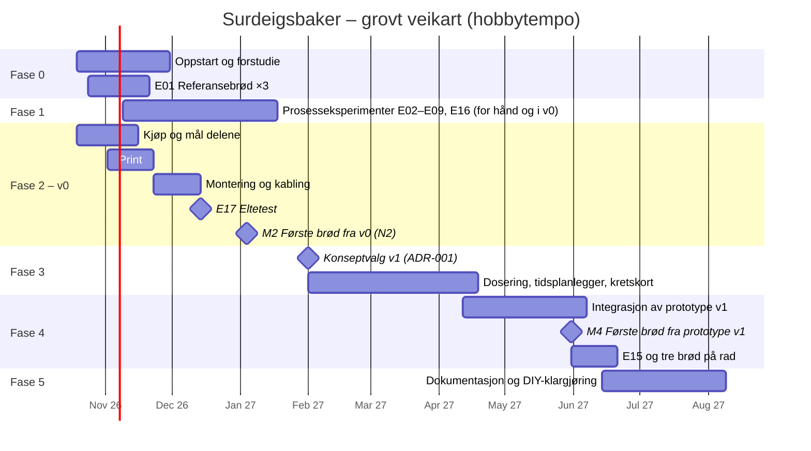

# 04 – Veikart: fra idé til første brød

Planen går i seks faser. Hver fase avsluttes med en **port** (G0–G5): et sett med kriterier som må være oppfylt før neste fase starter for fullt. Fasene overlapper med vilje. Eksperimentene i én fase gir data til designet i den neste.

Tidsanslagene forutsetter **hobbytempo, ca. 6–10 timer i uka**, og er grove. De justeres ved hver port.

> **Oppdatert 2026-10-16:** Etter [ADR-007](beslutninger/ADR-007-ingen-kjoling.md) (ingen kjøling) og [ADR-008](beslutninger/ADR-008-v0-design.md) (første maskindesign) bygges **v0 nå** som fase 2. Den er en K2-maskin uten kjøling og dosering. Hevekabinettet (K3) og den hackede brødmaskinen (K1) er ikke lenger nødvendige trinn. Byggeveiledningen ligger i [`hardware/v0/`](../hardware/v0/README.md).

## Fase 0 – Oppstart og forstudie (uke 1–6)

**Mål:** Forstå feltet, etablere referansen og fryse kravene.

- [ ] Opprett repoet, GitHub-prosjekttavle og etiketter (`eksperiment`, `bakelogg`, `research`, `hardware`, `firmware`, `sikkerhet`)
- [ ] **E01:** Bak referansebrødet tre ganger med full logg, og gjør skjeemål om til gram
- [ ] Forstudie FO1–FO8 etter [forskningsplanen](02-forskningsplan.md), med et kort kunnskapsnotat (1–3 sider) per område
- [ ] Analyser kjente løsninger og søk i patenter (FO2)
- [ ] Mål kjøkkenbenken (plass under overskap, plassering av stikkontakt og hvilken sikringskurs den har)
- [ ] Velg plattform for måleoppsettet i fase 1 (ADR-002, se [arkitektur](07-arkitektur.md))
- [ ] Sett opp verktøykjeden for agentstyrt design ([`10-verktoykjede.md`](10-verktoykjede.md), ADR-005). Installer de låste versjonene, legg inn CI-sjekker og test sikkerhetssperrene i `.claude/settings.json`.
- [ ] Innfør en månedlig rutine for å skanne nye verktøy og MCP-servere
- [ ] Bestill deler til fase 1 ([handleliste](09-budsjett-og-innkjop.md))

**Port G0:** Kravspesifikasjon v1 er frosset (oppdatert [`00-visjon-og-suksesskriterier.md`](00-visjon-og-suksesskriterier.md)), E01 er fullført og alle kunnskapsnotatene er skrevet.

## Fase 1 – Smart hevekabinett (K3) og maskinvennlig oppskrift (uke 4–12)

**Mål:** Bygge hevekabinettet, som er første nyttige maskin (N1). Finne ut hvilke håndgrep maskinen *ikke* trenger å gjøre, og lage en fermenteringsmodell.

- [ ] Bygg måleoppsettet: ESP32 med temperaturfølere, ToF-sensor, lastcelle og logging til dashboard eller CSV. ESPHome-oppsettet valideres og kompileres i CI og testes i Wokwi før et menneske flasher det.
- [ ] ~~Bygg hevekabinettet (K3)~~ **Valgfritt etter ADR-008.** v0 har varme, hevemåling og varsler, og kan brukes som eksperimentkammer når den er bygget.
- [ ] Kjør E02 og E03 (surdeigskinetikk og «klar»-signal)
- [ ] Kjør E04–E09 og E16 (forenklinger av prosessen og ventevinduet etter bulk) med kjøkkenmaskin, kjøleskap og vanlig ovn
- [ ] Lag fermenteringsmodell v1 og maskinvennlig oppskrift v1 ([`oppskrifter/maskinvennlig-v0.yaml`](../oppskrifter/maskinvennlig-v0.yaml))

**Port G1:** H0 er bekreftet eller avkreftet. Det betyr at vi vet om overleveringen skal være «tipp og stek» eller «med forming». Modellen treffer innenfor ±1 t, og vi vet hvor lenge deigen kan vente ved romtemperatur etter bulk (E16).

## Fase 2 – Bygg v0 (K2 uten kjøling) (uke 1–12)

**Mål:** En maskin på benken som blander, elter, bulkhever med bretting og varsler når deigen er klar for forming (N2). Hele kjeden fra fastvare til sikkerhet skal fungere på ekte maskinvare.

Alt som trengs, ligger i [`hardware/v0/`](../hardware/v0/README.md): STL, STEP, DXF, stykkliste, koblingsskjema og byggeveiledning. Fastvaren ligger i [`firmware/v0/`](../firmware/v0/README.md).

- [ ] Kjøp bollen, motoren og modulene, og **mål dem**. Oppdater [`hardware/spec/v0.yaml`](../hardware/spec/v0.yaml) og bygg CAD på nytt.
- [ ] Bestill profiler (kappet) og plater (kappet etter DXF)
- [ ] Print delene ([`printliste.md`](../hardware/v0/printliste.md)). Lagerhuset først, som passformtest.
- [ ] Bøy kroken etter bøyemalen og sjekk den mot bollen
- [ ] Monter ramme, bunn, gulv, varmeplate, lokk og kabling
- [ ] Idriftsetting trinn for trinn: uten strøm, uten last, fastvare, varme med vann, motor uten bolle
- [ ] **E17: Eltetest** med testdeig. Den største tekniske risikoen i v0.
- [ ] Test sikkerhetskjeden: lokkbryter, nødstopp, KSD301, termosikring og føler som mangler
- [ ] Bak etter den maskinvennlige oppskriften og stek i vanlig ovn

**Port G2 / milepæl M2:** 🍞 *Første brød av deig laget i v0* (N2). Lokkbryteren, nødstoppen og varmevernet er testet og virker.

**Valgfritt:** Brødmaskinvarianten (K1) kan fortsatt bygges som en enkel «Surdeigsbaker Mini», men den er ikke lenger på den kritiske veien.

## Fase 3 – Konseptvalg og delsystemer for K2 (uke 15–26)

**Mål:** Velge konsept og få hvert delsystem til å oppfylle spesifikasjonen sin hver for seg.

- [ ] **ADR-001: Konseptvalg for v1** (Pugh-matrise oppdatert med data fra v0, E05–E09, E16 og E17, se [konsepter](03-konsepter.md))
- [ ] Forbedret elte- og hevemodul basert på erfaringene fra v0: kroken, bollen, lastceller og bedre hevemåling (E14)
- [ ] Lavere maskin (motoren ved siden av bollen?) og bedre varmestyring (**E13**)
- [ ] Overlevering: bolle og hevekurv som er lette å ta ut og tømme for hånd (E10)
- [ ] Dosering (for N3): snegle for mel, doserer for tørt salt og pumpe for vann. Maskinen lager saltlaken selv (E11 og E12).
- [ ] Tidsplanlegger som treffer et valgt tidspunkt for forming, basert på fermenteringsmodellen fra E02
- [ ] Kretskort i KiCad 10 i stedet for hullkortet. Fortsatt bare 24 V (SELV). Se [verktøykjeden](10-verktoykjede.md).

**Port G3:** Alle delsystemene har bestått testene sine. CAD-modellen av hele maskinen viser at den får plass innenfor rammene.

## Fase 4 – Integrasjon: prototype v1 (uke 25–34)

**Mål:** Én maskin på benken som leverer deig klar for forming til planlagt tid, og som doserer selv (N3).

- [ ] Ramme og kabinett, montering og kabling
- [ ] Trinnvis idriftsettelse: tørrkjøring, deretter vann, deretter deig
- [ ] **E15:** Ubemannet drift og feilinjeksjon (krav før første kjøring over natten)
- [ ] Første integrerte bakinger (stekt i vanlig ovn), og deretter iterasjon til akseptansekriteriene er nådd

**Port G4 / milepæl M4:** 🎉 **I MÅL.** Alle akseptansekriteriene i [`00-visjon-og-suksesskriterier.md`](00-visjon-og-suksesskriterier.md) er oppfylt, inkludert tre godkjente brød på rad.

## Fase 5 – Dokumentasjon og DIY-klargjøring (etter M4)

- [ ] Stykkliste (BOM) med leverandører og priser, byggeveiledning med bilder, koblingsskjema og kalibreringsprosedyre
- [ ] Fastvare v1.0 og oppskriftsbibliotek
- [ ] Prosjektside med byggelogg (f.eks. Hackaday.io eller blogg) og invitasjon til andre som vil bygge
- [ ] Skisse til v2: Surhild-modulen (N4), forming (N5) og eventuell integrasjon med smartovn
- [ ] Vurder en enkel DIY-variant basert på K1 («Surdeigsbaker Mini»)

**Port G5:** Én annen person har fulgt dokumentasjonen og kommet i gang. Dette er strekkmålet.

## Risikoregister

S = sannsynlighet, K = konsekvens (L = lav, M = middels, H = høy).

| ID | Risiko | S | K | Tiltak | Følges opp i |
|---|---|---|---|---|---|
| R1 | Deigen er vanskelig å få ut av bollen eller kurven, eller mister luft | M | M | E10, slippbelegg (PTFE er greit, siden det ikke er varme), kald deig, mel og hevekurv med klede | Fase 1, 3 |
| R2 | Uformet brød («tipp og stek») blir for dårlig | M | M | E06. Varianten «med forming» er en sikker reserveplan (to korte grep). | Fase 1 |
| R3 | Overoppheting, motorbrann eller elektrisk feil ved ubemannet drift | L | H | Termosikring på varmen, overvåking av motorblokkering, sikkerhetsvakt, jordfeilbryter. Ingen kjøring over natten før E15 er bestått. | Alle |
| R4 | ~~Kjølingen er for svak, gir kondens eller bråker~~ | – | – | Utgår: ingen kjøling ([ADR-007](beslutninger/ADR-007-ingen-kjoling.md)) | – |
| R5 | Meldoseringen er upålitelig (jf. Rotimatic) | H | M | N2 (forhåndsveide porsjoner) som reserveplan. Snegle med omrører. E11. | Fase 3 |
| R6 | Rengjøringen er så tungvint at maskinen ikke blir brukt | M | H | Avtakbare deler som tåler oppvaskmaskin, designet inn fra start | Fase 3 |
| R7 | Variasjon i surdeigen gjør tidsplanen upresis | **H** | M | Uten kald buffer før forming må temperaturen under bulk justere tiden. Sensorbasert «klar»-signal (E02, E03, E14). Kjøleskapet er bufferen etter forming. | Fase 1, 3 |
| R8 | Prosjektet vokser ut av kontroll, eller motivasjonen forsvinner | H | H | Trapp med nyttige delmål (M1 hevekabinett, M2 deigmaskin), streng avgrensning av v1 og offentlig byggelogg | Alle |
| R9 | Varselet om forming kommer på et upraktisk tidspunkt (f.eks. kl. 02) | M | M | Tidsplanlegger med tillatte tidsrom. Start levain og deig til riktig tid. | Fase 3 |
| R10 | Motorvarme eller fukt skader elektronikken | L | M | Elektronikken i sokkelen under gulvplata, motoren utenfor kammeret på lokket | Fase 2 |
| R11 | Materialer som ikke er godkjent for matkontakt (3D-print, smøremidler) | M | M | Materialregler i [`06-sikkerhet.md`](06-sikkerhet.md). I v0 berører bare rustfritt stål og silikon deigen. Tettede lager med matgodkjent fett. | Fase 2 |
| R12 | C-kroken i senter elter dårlig, eller deigen går bare rundt med kroken | M | H | **E17** som første test etter montering. Reserve: spiralkrok, krok ut fra senter, høyere fart. | Fase 2 |
| R13 | v0 er for høy for plassen under overskapene (541 mm lukket, ca. 700 mm åpen) | H | L | Trekk maskinen fram før lokket åpnes. Lavere design i v1. | Fase 3 |

## Arbeidsform

- **Ukerytme:** én baking i uka med bakelogg, og én eller to byggeøkter.
- **Issues:** ett issue per eksperiment og per baking, fra malene i `.github/ISSUE_TEMPLATE`.
- **Beslutninger:** viktige valg skrives som korte ADR-er i [`docs/beslutninger/`](beslutninger/).
- **Portgjennomgang:** ved hver port oppdateres veikartet, risikoregisteret og budsjettet.
- **Åpenhet:** bilder og data fra mislykkede brød legges også ut. Det er gjerne der lærdommen er.
