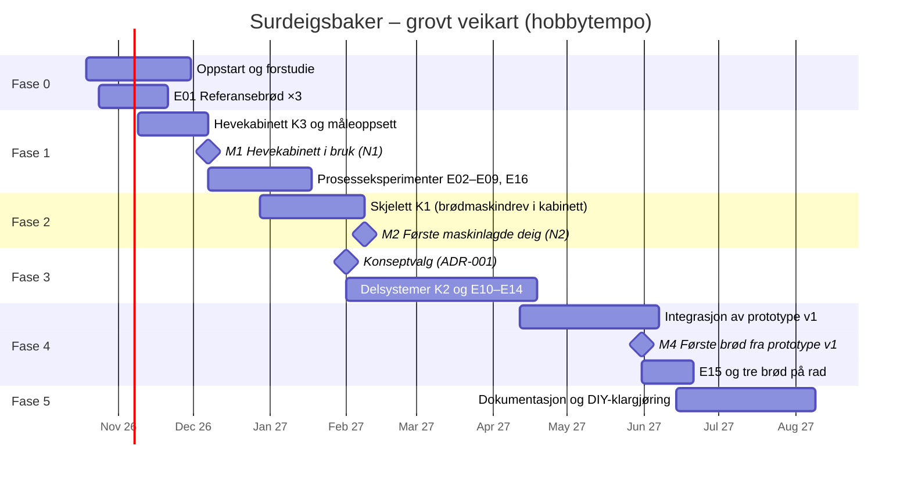

# 04 – Veikart: fra idé til første brød

Planen går i seks faser. Hver fase avsluttes med en **port** (G0–G5): et sett med kriterier som må være oppfylt før neste fase starter for fullt. Fasene overlapper med vilje. Eksperimentene i én fase gir data til designet i den neste.

Tidsanslagene forutsetter **hobbytempo, ca. 6–10 timer i uka**, og er grove. De justeres ved hver port.

## Fase 0 – Oppstart og forstudie (uke 1–6)

**Mål:** Forstå feltet, etablere referansen og fryse kravene.

- [ ] Opprett repoet, GitHub-prosjekttavle og etiketter (`eksperiment`, `bakelogg`, `research`, `hardware`, `firmware`, `sikkerhet`)
- [ ] **E01:** Bak referansebrødet tre ganger med full logg, og gjør skjeemål om til gram
- [ ] Forstudie FO1–FO8 etter [forskningsplanen](02-forskningsplan.md), med et kort kunnskapsnotat (1–3 sider) per område
- [ ] Analyser kjente løsninger og søk i patenter (FO2)
- [ ] Mål kjøkkenbenken (plass under overskap, plassering av stikkontakt og hvilken sikringskurs den har)
- [ ] Velg plattform for måleoppsettet i fase 1 (ADR-002, se [arkitektur](07-arkitektur.md))
- [ ] Sett opp verktøykjeden for agentstyrt design ([`10-verktoykjede.md`](10-verktoykjede.md), ADR-005). Installer de låste versjonene, legg inn CI-sjekker og test sikkerhetssperrene i `.claude/settings.json`.
- [ ] Innfør en månedlig rutine for å skanne nye verktøy og MCP-servere
- [ ] Bestill deler til fase 1 ([handleliste](09-budsjett-og-innkjop.md))

**Port G0:** Kravspesifikasjon v1 er frosset (oppdatert [`00-visjon-og-suksesskriterier.md`](00-visjon-og-suksesskriterier.md)), E01 er fullført og alle kunnskapsnotatene er skrevet.

## Fase 1 – Smart hevekabinett (K3) og maskinvennlig oppskrift (uke 4–12)

**Mål:** Bygge hevekabinettet, som er første nyttige maskin (N1). Finne ut hvilke håndgrep maskinen *ikke* trenger å gjøre, og lage en fermenteringsmodell.

- [ ] Bygg måleoppsettet: ESP32 med temperaturfølere, ToF-sensor, lastcelle og logging til dashboard eller CSV. ESPHome-oppsettet valideres og kompileres i CI og testes i Wokwi før et menneske flasher det.
- [ ] Bygg **hevekabinettet (K3)**: et ombygd lite vinkjøleskap med kompressor (styres eksternt, kjølekretsen åpnes ikke), svak varme med termosikring, hevemåling, tidsplan og varsler («form deigen nå», «forvarm ovnen nå»). Kabinettet er både eksperimentkammeret og første trinn av maskinen.
- [ ] Kjør E02 og E03 (surdeigskinetikk og «klar»-signal)
- [ ] Kjør E04–E09 og E16 (forenklinger av prosessen og kaldhold) med kjøkkenmaskin, kabinett og vanlig ovn
- [ ] Lag fermenteringsmodell v1 og maskinvennlig oppskrift v1 ([`oppskrifter/maskinvennlig-v0.yaml`](../oppskrifter/maskinvennlig-v0.yaml))

**Milepæl M1:** Hevekabinettet er i bruk til vanlig baking (N1).

**Port G1:** H0 er bekreftet eller avkreftet. Det betyr at vi vet om overleveringen skal være «tipp og stek» eller «med forming», og om kald heving skal skje i bulk eller etter forming. Modellen treffer innenfor ±1 t, og vi vet hvor lenge deigen kan kaldholdes.

## Fase 2 – Gangbart skjelett: brødmaskin i kabinettet (K1) (uke 10–16)

**Mål:** Få maskinen til å elte og bulkheve selv (N2), og få hele programvarekjeden til å fungere på ekte maskinvare: oppskrift, styring, sikkerhet, logging og varsling.

- [ ] Kjøp en brukt brødmaskin (Finn.no). Demonter, dokumenter og mål motoren og drivverket (en «teardown»). Varmeelementet på ca. 500 W brukes ikke. Kabinettet har egen svak varme.
- [ ] Monter drivverket og formen i hevekabinettet. Mål motorvarmen og ta hensyn til den i kjølingen.
- [ ] Styring av motoren (relé/triac, overvåking av blokkering) og en **uavhengig termosikring** på varmeelementet i kabinettet
- [ ] Implementer sikkerhetsvakten, oppskriftsmotoren (tilstandsmaskin) og loggingen, se [arkitektur](07-arkitektur.md)
- [ ] Kjør den maskinvennlige oppskriften etter manuell veiing (N2), og stek i vanlig ovn
- [ ] Gjør feilinjeksjon som en «mini-E15»

**Port G2 / milepæl M2:** 🍞 *Første brød av maskinlaget surdeigsdeig* (N2). Sikkerhetsarkitekturen er verifisert ved at termosikringen er testet og løser ut.

## Fase 3 – Konseptvalg og delsystemer for K2 (uke 15–26)

**Mål:** Velge konsept og få hvert delsystem til å oppfylle spesifikasjonen sin hver for seg.

- [ ] **ADR-001: Konseptvalg** (Pugh-matrise oppdatert med data fra E05–E09 og E16, se [konsepter](03-konsepter.md))
- [ ] Elte- og hevemodul: avtakbar bolle i rustfritt stål, krok med girmotor i lokket, lastceller og ToF (E14)
- [ ] Kammer: isolasjon, kompressor eller Peltier, svak varme og håndtering av kondens (**E13**)
- [ ] Overlevering: bolle og hevekurv som er lette å ta ut og tømme for hånd (E10)
- [ ] Dosering (for N3): snegle for mel, pumpe for vann og saltlake (E11 og E12)
- [ ] Mekanisk konsept i CAD (build123d og FreeCAD) og elektrisk skjema (KiCad 10, med separat 230 V-kort og lavspenningskort), se [verktøykjeden](10-verktoykjede.md)

**Port G3:** Alle delsystemene har bestått testene sine. CAD-modellen av hele maskinen viser at den får plass innenfor rammene.

## Fase 4 – Integrasjon: prototype v1 (uke 25–34)

**Mål:** Én maskin på benken som leverer stekeklar deig til planlagt tid.

- [ ] Ramme og kabinett, montering og kabling
- [ ] Trinnvis idriftsettelse: tørrkjøring, deretter vann, deretter deig
- [ ] **E15:** Ubemannet drift og feilinjeksjon (krav før første kjøring over natten)
- [ ] Første integrerte bakinger (stekt i vanlig ovn), og deretter iterasjon til akseptansekriteriene er nådd

**Port G4 / milepæl M4:** 🎉 **I MÅL.** Alle akseptansekriteriene i [`00-visjon-og-suksesskriterier.md`](00-visjon-og-suksesskriterier.md) er oppfylt, inkludert tre godkjente brød på rad.

## Fase 5 – Dokumentasjon og DIY-klargjøring (etter M4)

- [ ] Stykkliste (BOM) med leverandører og priser, byggeveiledning med bilder, koblingsskjema og kalibreringsprosedyre
- [ ] Fastvare v1.0 og oppskriftsbibliotek
- [ ] Prosjektside med byggelogg (f.eks. Hackaday.io eller blogg) og invitasjon til andre som vil bygge
- [ ] Skisse til v2: Surhild-modulen (N4), forming (N5) og eventuell integrasjon med smartovn
- [ ] Vurder en enkel DIY-variant basert på K1 («Surdeigsbaker Mini»)

**Port G5:** Én annen person har fulgt dokumentasjonen og kommet i gang. Dette er strekkmålet.

## Risikoregister

S = sannsynlighet, K = konsekvens (L = lav, M = middels, H = høy).

| ID | Risiko | S | K | Tiltak | Følges opp i |
|---|---|---|---|---|---|
| R1 | Deigen er vanskelig å få ut av bollen eller kurven, eller mister luft | M | M | E10, slippbelegg (PTFE er greit, siden det ikke er varme), kald deig, mel og hevekurv med klede | Fase 1, 3 |
| R2 | Uformet brød («tipp og stek») blir for dårlig | M | M | E06. Varianten «med forming» er en sikker reserveplan (to korte grep). | Fase 1 |
| R3 | Overoppheting, motorbrann eller elektrisk feil ved ubemannet drift | L | H | Termosikring på varmen, overvåking av motorblokkering, sikkerhetsvakt, jordfeilbryter. Ingen kjøring over natten før E15 er bestått. | Alle |
| R4 | Kjølingen er for svak, gir kondens eller bråker | M | H | Kompressor (ombygd vinkjøleskap) framfor Peltier, E13, isolasjon og tett kammer, støymåling | Fase 1, 3 |
| R5 | Meldoseringen er upålitelig (jf. Rotimatic) | H | M | N2 (forhåndsveide porsjoner) som reserveplan. Snegle med omrører. E11. | Fase 3 |
| R6 | Rengjøringen er så tungvint at maskinen ikke blir brukt | M | H | Avtakbare deler som tåler oppvaskmaskin, designet inn fra start | Fase 3 |
| R7 | Variasjon i surdeigen gjør tidsplanen upresis | M | M | Kald heving og kaldhold som buffer, sensorbasert «klar»-signal (E02, E03, E16) | Fase 1 |
| R8 | Prosjektet vokser ut av kontroll, eller motivasjonen forsvinner | H | H | Trapp med nyttige delmål (M1 hevekabinett, M2 deigmaskin), streng avgrensning av v1 og offentlig byggelogg | Alle |
| R9 | Varsler kommer på upraktiske tidspunkter (forming kl. 02, forvarming før du er våken) | M | M | Tidsplanlegger med tillatte tidsrom og kaldhold som buffer | Fase 1, 4 |
| R10 | Motorvarme og kondens skader elektronikken | M | M | Elektronikken i et eget rom utenfor kammeret, tette gjennomføringer, temperaturovervåking | Fase 2, 3 |
| R11 | Materialer som ikke er godkjent for matkontakt (3D-print, smøremidler) | M | M | Materialregler i [`06-sikkerhet.md`](06-sikkerhet.md) | Fase 3 |

## Arbeidsform

- **Ukerytme:** én baking i uka med bakelogg, og én eller to byggeøkter.
- **Issues:** ett issue per eksperiment og per baking, fra malene i `.github/ISSUE_TEMPLATE`.
- **Beslutninger:** viktige valg skrives som korte ADR-er i [`docs/beslutninger/`](beslutninger/).
- **Portgjennomgang:** ved hver port oppdateres veikartet, risikoregisteret og budsjettet.
- **Åpenhet:** bilder og data fra mislykkede brød legges også ut. Det er gjerne der lærdommen er.
