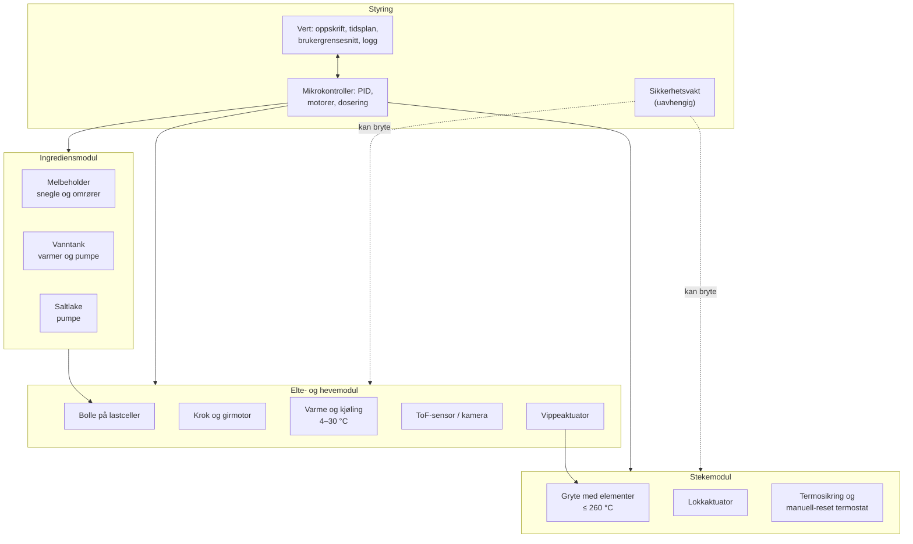
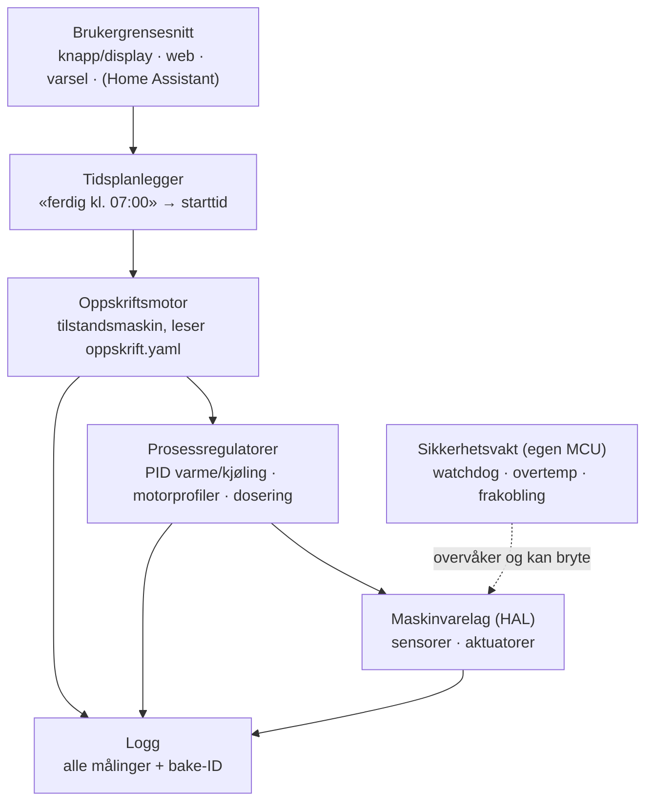
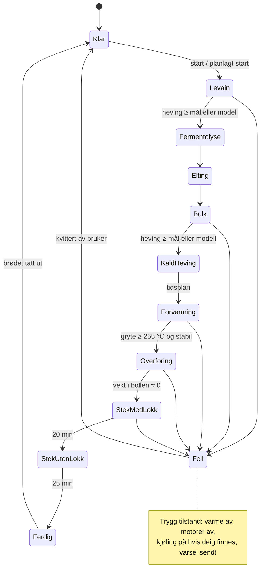

# 07 – Systemarkitektur (utkast)

Arkitekturen tar utgangspunkt i konsept C, «bolle over gryte» ([`03-konsepter.md`](03-konsepter.md)). Delsystemene er definert slik at de også passer konsept D. Alt her er et **utkast** som skal modnes i fase 1–3.

## 1. Moduler

## 2. Sensorer og aktuatorer (kandidater)

| Funksjon | Kandidat | Merknad |
|---|---|---|
| Ovns- og grytetemperatur | PT1000 + MAX31865 (0,5 °C) eller type K + MAX31856 | MAX31855 har bare ±2 °C nøyaktighet. Alle tre støttes av både ESPHome og Klipper. |
| Deig- og kammertemperatur | DS18B20 (vanntett), NTC eller PT1000 | |
| Romklima | SHT4x | Romtemperaturen brukes i modellen. Panasonic-brødmaskiner gjør det samme. |
| Heving i surdeigsglass | VL6180X (ToF, kort rekkevidde) | Dekkvindu må kalibreres for krysstale |
| Heving i bollen | VL53L1X (minimum ca. 4 cm), eventuelt kamera | E14 |
| Vekt (dosering og stekesvinn) | 5–10 kg lastcelle + NAU7802 eller HX711 | Tarer før hver tilsetning. Holdes unna ovnsvarme. Krypning ca. 1 g på en 5 kg celle. |
| Vekt (salt og surdeig) | Egen lastcelle på 0,5–1 kg | Eller saltlake, så denne kan sløyfes |
| CO₂ (valgfritt, E03) | STC31 (0–100 vol%) eller SprintIR-6S-100 | SCD41 blir mettet |
| Varmeelement | ≤ 1800 W, CE/ENEC-godkjent | Brytes med nullgjennomgangs-SSR (syklus på 1–2 s), med topolet relé eller kontaktor i serie |
| Kjøling | Kompressorenhet (fra vinkjøleskap eller kjøleboks) eller Peltier (2 × TEC1-12706-klasse) | Se avsnitt 4 |
| Eltemotor | 100–200 W girmotor, ca. 80–150 o/min, ca. 5–10 N·m (anslag) | Detekterer blokkering ut fra strømtrekk |
| Melsnegle | Steppermotor og snegle av rustfritt stål med omrører | Kjøres raskt til ca. 90 % av mengden, deretter i pulser styrt av vekta |
| Vann og saltlake | Peristaltiske pumper | Doserer etter vekt, ikke volum |
| Vipp og lokk | Stepper- eller lineæraktuator med endebrytere | |

## 3. Effektbudsjett (én 10 A-kurs)

En 10 A-kurs gir 2300 W, men det kan være andre apparater på samme kurs. Ved belastning over lang tid bør man holde god margin.

| Fase | Forbruker | Effekt |
|---|---|---|
| Forvarming og steking | Varmeelement | ≤ 1800 W |
| | Elektronikk og vifter | ca. 20–40 W |
| Elting | Eltemotor | 100–400 W |
| Heving (kald) | Kompressor ca. 50 W **eller** Peltier 40–80 W | |
| **Sperre i fastvaren** | Varme og motor går aldri på full effekt samtidig | **Maks ≤ 2000 W** |

Til sammenligning bruker brødmaskiner 480–800 W totalt (element 430–550 W og motor ca. 100 W). Det er en del av forklaringen på at de bare når ca. 140–155 °C.

## 4. Termikk: grove tall

- **Forvarming:** En 24 cm emaljert jerngryte (ca. 4,5 kg, tåler 280 °C) lagrer ca. 0,13 kWh ved 250 °C. Teoretisk tar det ca. 5 min på 1,5 kW, men i praksis tar det 30–60 min, fordi mye varme går tapt. **God isolasjon er viktigere enn mer effekt.** Lettere gryter av karbonstål varmes raskere opp, men gir mindre varmebuffer (E08).
- **Kjøling:** Et kammer på 15–20 L med 40 mm skumisolasjon trenger ca. 15–25 W netto kjøleeffekt for å holde 4 °C og kjøle 1 kg deig.
  - Med **Peltier** (COP ca. 0,3–0,5) gir det **40–80 W** elektrisk. Det går, men er marginalt, særlig i et varmt kjøkken ved siden av en varm ovn. Kondens på kaldsiden må tettes godt (lukket cellegummi og en ekstra fuktsperre).
  - En **kompressor** (f.eks. Secop BD35F, COP ca. 1,9) er omtrent fire ganger mer effektiv. Det enkleste og tryggeste er å **bygge om et lite vinkjøleskap eller en kompressorkjøleboks** og styre den eksternt. Det er slik BrewPi og Fermentrack gjør det for ølgjæring. Selve kjølekretsen skal du ikke åpne, siden det krever sertifisering.
  - **Anbefaling:** Bruk kompressor (ombygd vinkjøleskap) i hevekassen i fase 1. Bruk Peltier i surdeigsmodulen, der lasten er liten (jf. Brød & Taylor Sourdough Home, maks ca. 38 W). I fase 3 avgjøres kjølingen av bollen.
- **Beskytt Peltier og elektronikk mot ovnen** med avstand: ≥ 50 mm isolasjon og luftspalte, kjøleribbe på varmsiden med kald inntaksluft, og utkobling ved ca. 70 °C på varmsiden. Merk at forvarmingen av ovnen ofte overlapper slutten av den kalde hevingen.
- **Isolasjon:** Bruk steinull eller AES-ull (alkaline earth silicate). **Ikke bruk ildfast keramisk fiber av typen 1260**, siden den er klassifisert som kreftfremkallende.
- **Ledninger:** silikon tåler 150–200 °C, PTFE 200–250 °C og glimmer/glassfiber (MGT) ca. 450 °C. Bruk MGT nær elementene.
- **Plast:** PLA ca. 55 °C, PETG ca. 75 °C, ASA ca. 95 °C og PC ca. 110 °C (formbestandighet). Hold 15–20 °C margin. Ingen 3D-print i stekemodulen.

## 5. Styring: plattformvalg

| Alternativ | Fordeler | Ulemper | Egnet for |
|---|---|---|---|
| **ESP32 + ESPHome** | YAML-oppsett som kan versjoneres. PID-regulering med *både* varme- og kjøleutgang i samme sløyfe, med autotuning. Ferdige komponenter for MAX318xx, HX711 og NAU7802. Wi-Fi og Home Assistant. | Lange oppskrifter med mange tilstander passer dårlig i YAML-skript | **Måleoppsett og hevekasse i fase 1** og surdeigsmodulen |
| **Klipper** (Raspberry Pi + 3D-skriverkort) | Moden varmesikkerhet (min/max-temperatur, `verify_heater`), steppere (`manual_stepper`), støtte for lastceller (fra v0.13, 2025), makroer og API via Moonraker | Laget for 3D-skrivere. Oppskriftslogikk som går over mange timer, bør ligge i et eget program på verten. PWM-syklusen må settes til 1–2 s for SSR. | **Kandidat for mikrokontrollerlaget i prototype v1** |
| **Raspberry Pi + egen fastvare på MCU** | Full kontroll | Mest arbeid. Sikkerheten må bygges selv. | Hvis Klipper begrenser for mye |
| **MadMachine SwiftIO Micro** (Swift) | Swift på mikrokontroller, kraftig MCU (Cortex-M7 600 MHz), Feather-format | Ingen Wi-Fi. SDK-et er alfa/beta. Mangler drivere for MAX31855/31865, HX711 og NAU7802. Tilgjengeligheten er usikker. | Hobbyspor eller tilleggsmodul. **Aldri eneste sikkerhetslag.** |

**Forslag:**

1. **Fase 1:** ESP32 med ESPHome (se [ADR-002](beslutninger/ADR-002-plattform-maaleoppsett.md)).
2. **Fase 2–4:** to nivåer.
   - En **vert** (Raspberry Pi) kjører oppskriftsmotor, tidsplanlegger, brukergrensesnitt, logging og eventuelt kamera.
   - En **mikrokontroller** tar sanntidsoppgavene: PID, motorer og dosering. Klipper er hovedkandidaten.
   - I tillegg kommer en **separat sikkerhetsvakt** (lag 2 i [`06-sikkerhet.md`](06-sikkerhet.md)).
3. Valget tas i ADR-004 ved port G2.

## 6. Programvarearkitektur

### Tilstandsmaskin (forenklet)

Hver baking får en **bake-ID**. Alle målinger logges med bake-ID-en, slik at loggen kan kobles til bakeloggen og brødkortet. Oppskriftsformatet er beskrevet som et utkast i [`oppskrifter/maskinvennlig-v0.yaml`](../oppskrifter/maskinvennlig-v0.yaml).

## 7. Åpne arkitekturspørsmål

- Kjøles bollen med kald luft fra en kompressorenhet, med en kappe og væskesløyfe, eller med Peltier direkte?
- Hvordan skjermes bollen mot varmen fra gryta, særlig når lokket er av i 25 min? En termisk luke mellom modulene?
- Kan lastcellene under bollen også brukes til å oppdage at deigen har sluppet ved overføringen?
- Sikkerhetsvakt: egen liten MCU, eller en ren maskinvarekrets (komparator og watchdog-IC)?
- Brukergrensesnitt: fysisk knapp og display, bare web, eller begge?
