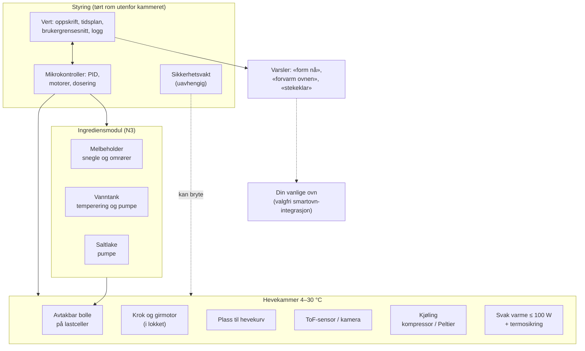
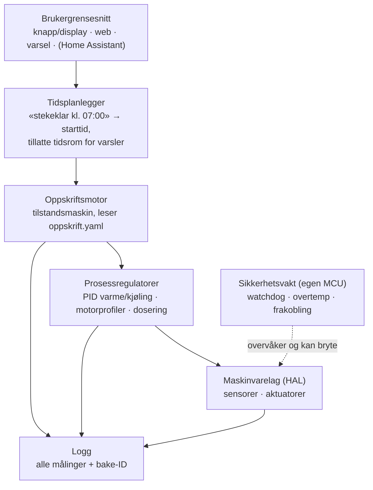
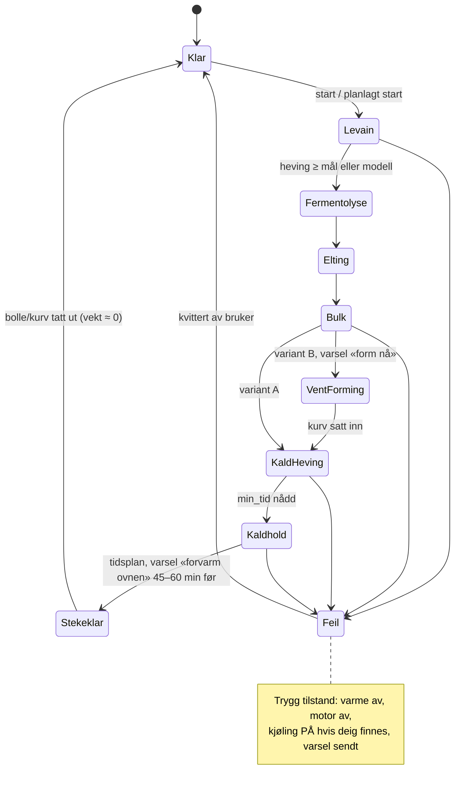

# 07 – Systemarkitektur (utkast)

Maskinen leverer **stekeklar deig**, og stekingen skjer i vanlig ovn ([ADR-006](beslutninger/ADR-006-steking-i-vanlig-ovn.md)). Arkitekturen tar utgangspunkt i konsept K2, «eltebolle i hevekammer» ([`03-konsepter.md`](03-konsepter.md)). Delsystemene er definert slik at de også passer trinnene på veien: K3 (hevekabinett) og K1 (brødmaskin i kjøleskap). Alt her er et **utkast** som skal modnes i fase 1–3.

## 1. Moduler

## 2. Sensorer og aktuatorer (kandidater)

| Funksjon | Kandidat | Merknad |
|---|---|---|
| Kammer- og deigtemperatur | DS18B20 (vanntett), PT1000 + MAX31865 for bedre nøyaktighet | Deigtemperaturen måles med føler mot bollen eller stikkføler |
| Romklima | SHT4x | Romtemperaturen brukes i modellen (som i Panasonic-brødmaskiner). Fukt i kammeret gir varsel om kondens. |
| Heving i surdeigsglass | VL6180X (ToF, kort rekkevidde) | Dekkvindu må kalibreres for krysstale og dugg |
| Heving i bollen | VL53L1X (minimum ca. 4 cm), eventuelt kamera | E14 |
| Vekt (dosering) | 5–10 kg lastcelle + NAU7802 eller HX711 | Tarer før hver tilsetning. Temperaturdrift ved 4–30 °C må kompenseres. |
| CO₂ (valgfritt, E03) | STC31 (0–100 vol%) eller SprintIR-6S-100 | SCD41 blir mettet |
| Kjøling | Kompressorenhet (ombygd vinkjøleskap eller kjøleboks) eller Peltier | Se avsnitt 4 |
| Varme | Varmefolie eller PTC-element ≤ 100 W, CE-godkjent | SSR eller relé, med topolet relé i serie og termosikring |
| Eltemotor | 100–200 W girmotor, ca. 80–150 o/min, ca. 5–10 N·m (anslag). I K1 brukes brødmaskinens motor. | Detekterer blokkering ut fra strømtrekk, termisk motorvern |
| Lokk og bolle til stede | Endebrytere eller reed-brytere | Kroken stopper når lokket åpnes eller bollen er tatt ut |
| Melsnegle (N3) | Steppermotor og snegle av rustfritt stål med omrører | Kjøres raskt til ca. 90 % av mengden, deretter i pulser styrt av vekta |
| Vann og saltlake (N3) | Peristaltiske pumper | Doserer etter vekt, ikke volum |

## 3. Effektbudsjett

Uten ovn blir effekten lav, og maskinen kan stå på en hvilken som helst stikkontakt.

| Fase | Forbruker | Effekt |
|---|---|---|
| Elting og bretting | Eltemotor | 100–400 W (kort tid) |
| Levain og bulk (24–27 °C) | Svak varme | ≤ 100 W, vanligvis mye mindre |
| Kald heving og kaldhold | Kompressor ca. 50 W **eller** Peltier 40–80 W | |
| Hele tiden | Elektronikk og vifter | ca. 10–20 W |
| **Sperre i fastvaren** | Varme og kjøling går aldri samtidig. Motoren og kompressoren startes ikke samtidig (startstrøm). | **Maks ≤ 600 W** |

## 4. Termikk: grove tall

- **Kjøling:** Et kammer på 15–20 L med 40 mm skumisolasjon trenger ca. 15–25 W netto kjøleeffekt for å holde 4 °C og kjøle 1 kg deig.
  - Med **Peltier** (COP ca. 0,3–0,5) gir det **40–80 W** elektrisk. Det går, men er marginalt i et varmt kjøkken. Kondens på kaldsiden må tettes godt (lukket cellegummi og en ekstra fuktsperre).
  - En **kompressor** (f.eks. Secop BD35F, COP ca. 1,9) er omtrent fire ganger mer effektiv. Det enkleste og tryggeste er å **bygge om et lite vinkjøleskap eller en kompressorkjøleboks** og styre den eksternt, slik BrewPi og Fermentrack gjør for ølgjæring. Selve kjølekretsen skal du ikke åpne, siden det krever sertifisering.
  - **Anbefaling:** Bruk kompressor (ombygd vinkjøleskap) i hevekabinettet (K3) og i K1. Peltier passer til surdeigsmodulen (N4), der lasten er liten (jf. Brød & Taylor Sourdough Home, maks ca. 38 W). Kjølingen i K2 avgjøres i fase 3 (E13).
- **Motorvarme:** 10 min elting med 100–200 W gir 60–120 kJ, og en del av det havner i deigen og kammeret. Det tas med i reguleringen og i ønsket deigtemperatur (friksjonsfaktoren).
- **Fra kald til varm:** Retarder-proofere i bakerier varmer langsomt opp fra kald tilstand for å unngå kondens på deigen. Det samme gjelder her hvis det kommer en varm etterheving etter kald heving.
- **Kondens og hygiene:** Kammeret er kaldt og fuktig i mange timer. Bruk tett innerkledning som kan rengjøres, drenering eller oppsamling av vann, og tørking eller ventilasjon mellom kjøringene. Elektronikken skal være utenfor kammeret.
- **Isolasjon:** Bruk lukket celleskum (PIR/XPS) eller den eksisterende isolasjonen i vinkjøleskapet.
- **Plast:** Det er ingen høytemperatursoner. PETG/ASA til deler i kammeret som ikke er i kontakt med mat (fukt og kulde). Ingen 3D-print i kontakt med mat.

## 5. Styring: plattformvalg

| Alternativ | Fordeler | Ulemper | Egnet for |
|---|---|---|---|
| **ESP32 + ESPHome** | YAML-oppsett som kan versjoneres. PID-regulering med *både* varme- og kjøleutgang i samme sløyfe, med autotuning. Ferdige komponenter for MAX318xx, HX711 og NAU7802. Wi-Fi og Home Assistant. | Lange oppskrifter med mange tilstander passer dårlig i YAML-skript | **Hevekabinettet (K3) i fase 1**, skjelettet (K1) og surdeigsmodulen |
| **Klipper** (Raspberry Pi + 3D-skriverkort) | Moden varmesikkerhet, steppere (`manual_stepper`), støtte for lastceller (fra v0.13, 2025), makroer og API via Moonraker | Laget for 3D-skrivere. Oppskriftslogikk som går over mange timer, bør ligge i et eget program på verten. | Kandidat for mikrokontrollerlaget i K2 når dosering med steppere kommer inn (N3) |
| **Raspberry Pi + egen fastvare på MCU** | Full kontroll | Mest arbeid. Sikkerheten må bygges selv. | Hvis de andre begrenser for mye |
| **MadMachine SwiftIO Micro** (Swift) | Swift på mikrokontroller, kraftig MCU (Cortex-M7 600 MHz), Feather-format | Ingen Wi-Fi. SDK-et er alfa/beta. Mangler drivere for MAX31855/31865, HX711 og NAU7802. Tilgjengeligheten er usikker. | Hobbyspor eller tilleggsmodul. **Aldri eneste sikkerhetslag.** |

**Forslag:**

1. **Fase 1–2:** ESP32 med ESPHome (se [ADR-002](beslutninger/ADR-002-plattform-maaleoppsett.md)). Med lav effekt og uten ovn kan det godt holde helt til N2.
2. **Fase 3–4 (K2, N3):** to nivåer.
   - En **vert** (Raspberry Pi eller Home Assistant) kjører oppskriftsmotor, tidsplanlegger, brukergrensesnitt, logging og eventuelt kamera.
   - En **mikrokontroller** tar sanntidsoppgavene: PID, motorer og dosering.
   - I tillegg kommer en **separat sikkerhetsvakt** (lag 2 i [`06-sikkerhet.md`](06-sikkerhet.md)).
3. Valget tas i ADR-004 ved port G2.

Utviklingsverktøyene (CAD, KiCad, ESPHome-CI, simulatorer) og sperrene for AI-agenter er beskrevet i [`10-verktoykjede.md`](10-verktoykjede.md).

## 6. Programvarearkitektur

### Tilstandsmaskin (forenklet)

Hver baking får en **bake-ID**. Alle målinger logges med bake-ID-en, slik at loggen kan kobles til bakeloggen og brødkortet. Oppskriftsformatet er beskrevet som et utkast i [`oppskrifter/maskinvennlig-v0.yaml`](../oppskrifter/maskinvennlig-v0.yaml).

### Varsler

| Varsel | Når | Kanal |
|---|---|---|
| «Tilsett 1 ss surdeig» (N2/N3) | Ved start, hvis bollen ikke har levain | Display og mobil |
| «Form deigen nå» (variant B) | Slutten av bulkhevingen, innenfor tillatt tidsrom | Mobil |
| «Forvarm ovnen nå» | 45–60 min før stekeklar tid (kan justeres etter ovnen din) | Mobil, eventuelt Home Assistant |
| «Deigen er stekeklar» | Ved stekeklar tid. Kaldholdet fortsetter til bollen eller kurven tas ut. | Mobil |
| Feil eller avvik | Umiddelbart (kjøling, motor, temperatur, strømbrudd) | Mobil og lys/lyd på maskinen |

### Valgfritt senere: integrasjon med smartovn

Mange nyere ovner kan fjernstyres (via produsentens app eller Home Assistant). Maskinen kan da *foreslå* forvarming til riktig tid. Regler (se [`06-sikkerhet.md`](06-sikkerhet.md)):

- Maskinen slår **aldri** på ovnen uten at brukeren bekrefter det, og bare via ovnens egen fjernstartfunksjon.
- Ingen fjernstart av ovnen når ingen er hjemme.
- Integrasjonen er en tilleggsfunksjon, utenfor v1.

## 7. Åpne arkitekturspørsmål

- Kjøling i K2: kald luft fra en kompressorenhet, en kappe rundt bollen med væskesløyfe, eller Peltier?
- Hvordan kobles kroken og lokket, slik at bollen kan tas ut enkelt og kroken kan vaskes?
- Skal hevekurven stå i kammeret samtidig med bollen (variant B), eller erstatte den?
- Hvordan håndteres og tørkes kondensen?
- Sikkerhetsvakt: egen liten MCU, eller en ren maskinvarekrets (komparator og watchdog-IC)?
- Brukergrensesnitt: fysisk knapp og display, bare web/app, eller begge?
