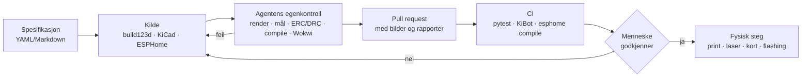

# 10 – Verktøykjede: design med AI-agenter

> **Sist verifisert: 2026-10-13.** Maskinen steker ikke ([ADR-006](beslutninger/ADR-006-steking-i-vanlig-ovn.md)). Det rapportene sier om ovn, gryte og 250 °C, er derfor bare bakgrunn. Feltet endrer seg svært raskt. Et GitHub-søk på «kicad mcp» gir over 200 repoer, og flere av dem oppdateres hver time. Dokumentet bygger på fire verktøyrapporter i [`forskning/verktoy/`](forskning/verktoy/). Nøkkelpåstandene er stikkprøvekontrollert mot PyPI, npm, GitLab og kildekoden på GitHub. Verktøylisten skannes på nytt hver måned (se [«Holde seg oppdatert»](#holde-seg-oppdatert)).

## Anbefalt verktøykjede

| Område | Hovedverktøy (versjon) | Agentintegrasjon | Mennesket godkjenner | Rapport |
|---|---|---|---|---|
| Mekanisk CAD | **build123d** `>=0.11.1,<0.12` (Python, STEP som hovedformat) | **build123d-mcp** 0.3.90: kjør, render, mål og eksporter | Endringer i deler nær varme- og matsonen | [3D-CAD](forskning/verktoy/3d-cad.md) |
| Plate, tegninger, enkel FEM | **FreeCAD 1.1.4** (SheetMetal, TechDraw, FEM/CalculiX), kjørt headless | `freecadcmd`-skript, eventuelt neka-nat/freecad-mcp **bare i container** | DXF før bestilling hos laserleverandør | [3D-CAD](forskning/verktoy/3d-cad.md) |
| Geometrisjekk | trimesh og manifold3d i pytest (CI) | Kjøres av agenten og av CI | – | [3D-CAD](forskning/verktoy/3d-cad.md) |
| Termikk (kjøling og svak varme) | **Eget RC-nettverk i Python** (SciPy, `ht`, CoolProp) for kammer, bolle og deig, eventuelt Elmer FEM for kuldebroer | Python og CLI, uten MCP | Antakelser og kalibrering mot E13 | [Simulering](forskning/verktoy/simulering-og-produksjon.md) |
| Mekanisme | FreeCAD Assembly (klaring), MuJoCo ved behov | Python | – | [Simulering](forskning/verktoy/simulering-og-produksjon.md) |
| 3D-print | PrusaSlicer 2.9.6 / OrcaSlicer 2.4.2 med CLI og låste profiler | Printer-MCP bare med bekreftelsessperre (`mcp__printer` krever godkjenning) | **Start av hver print** | [Simulering](forskning/verktoy/simulering-og-produksjon.md) |
| Render og byggeguide | Blender 5.2 LTS headless (bpy-skript) og GitBuilding | mcp-for-blender bare til utforsking (`SAFE_MODE`, telemetri av) | – | [Simulering](forskning/verktoy/simulering-og-produksjon.md) |
| Elektronikk | **KiCad 10.0.x**, med to kort: **230 V-kort** og **lavspenningskort (SELV)** | **kicad-happy** (gjennomgang og innkjøp) og **én** MCP-server som kan skrive (kicad-mcp-pro, som bare leser med mindre den settes opp til mer) | **Alt på 230 V**: avstander, plassering, ruting og DRC-unntak | [EDA](forskning/verktoy/elektronikk-eda.md) |
| EDA-CI | `kicad-cli` og **KiBot** i GitHub Actions (`kicad/kicad:10.0`), iBoM og KiRI-diff | ERC og DRC (`--exit-code-violations`) må passere før merge | Merge og bestilling av kort | [EDA](forskning/verktoy/elektronikk-eda.md) |
| Komponenter | KiCad-biblioteket, pcbparts-mcp (JLCPCB) og easyeda2kicad | Agenten foreslår | CE/ENEC-godkjenning for SSR, relé og AC/DC-modul | [EDA](forskning/verktoy/elektronikk-eda.md) |
| Kretssimulering | ngspice 47 med spicelib | Eventuelt ltspice-mcp (`run_code` slått av) | – | [Fastvare og lab](forskning/verktoy/firmware-simulering-lab.md) |
| Fastvare (lab) | **ESPHome** 2026.9.x via CLI (`esphome config`/`compile`) | Device Builder har innebygd MCP (`/api/mcp`), men `install` er sperret | **All flashing** | [Fastvare og lab](forskning/verktoy/firmware-simulering-lab.md) |
| Simulator | **Wokwi CLI** 0.28.1 (`wokwi-cli mcp`), ESPHome `host`, QEMU | Påkrevd steg før flashing | – | [Fastvare og lab](forskning/verktoy/firmware-simulering-lab.md) |
| Data | ESPHome → MQTT/HA → InfluxDB/CSV med bake-ID | ha-mcp `/readonly` eller Grafana MCP `--disable-write` | Agenten får aldri styre 230 V | [Fastvare og lab](forskning/verktoy/firmware-simulering-lab.md) |

**I bruk nå (v0):** Mønsteret under er tatt i bruk for v0. [`hardware/spec/v0.yaml`](../hardware/spec/v0.yaml) er spesifikasjonen. [`hardware/cad/`](../hardware/cad/README.md) er build123d-koden, som også kjører egne kontroller (printvolum, klaringer, kollisjon når lokket åpnes) og skriver [`sjekkrapport.md`](../hardware/v0/sjekkrapport.md). [`firmware/v0/`](../firmware/v0/README.md) er ESPHome-kilden, validert med `esphome config`. Koblingsskjemaet er foreløpig Markdown. KiCad kommer med kretskortet i v1.

**Mønsteret er det samme overalt:** Kilden er tekst i git. Agenten skriver og kontrollerer sitt eget arbeid. CI kjører sjekker som gir samme resultat hver gang. Mennesket godkjenner alt som kan skade.

## Prinsipper for agentstyrt maskinvaredesign

1. **Tekst framfor binærfiler.** Velg kildeformater som er lesbare og kan diffes i git: kode-CAD (Python), KiCad-filer (s-uttrykk), YAML for oppskrifter og ESPHome-oppsett. Da kan agenten lese og endre designet, og mennesket kan se gjennom endringen som en vanlig diff.
2. **Lukk sløyfen: agenten må kunne kontrollere sitt eget arbeid.** Hver endring etterfølges av en sjekk agenten kan lese: rendret bilde, målinger, ERC/DRC, simulering eller test i simulator. Ingen endring regnes som ferdig uten en slik sjekk.
3. **Mennesket godkjenner det som kan skade.** Alt som har med 230 V, varme, matkontakt eller fysisk handling å gjøre, skal godkjennes av et menneske. Det gjelder blant annet flashing av fastvare, utskrift på 3D-skriveren og påslag av varmeelementer eller instrumenter. Agenten får aldri gå forbi sikkerhetslagene i [`06-sikkerhet.md`](06-sikkerhet.md).
4. **Åpne formater i grensesnittene:** STEP og 3MF for mekanikk, KiCad og Gerber for kretskort, CSV for stykkliste og data. Da er prosjektet ikke låst til ett verktøy eller én MCP-server.
5. **MCP-servere er hjelpemidler, ikke sikkerhetsporter.** Sjekkene som avgjør om noe godkjennes (DRC, compile, pytest), kjøres med de offisielle CLI-verktøyene, som ikke endrer seg fra uke til uke.
6. **Vurder MCP-servere før de tas i bruk** (se under). Mange er små hobbyprosjekter, og flere kan kjøre vilkårlig kode i CAD-programmet eller på maskinen.
7. **Lås versjonene** (se [«Versjonslås»](#versjonslås)), og oppdater bevisst.

## Sikkerhetssperrer i Claude Code

Prosjektet har en egen [`.claude/settings.json`](../.claude/settings.json). Den gjør at Claude Code **alltid spør** før:

- **Flashing:** `esphome run`/`upload`, `idf.py flash`, `esptool`, `pio run -t upload` og `arduino-cli upload`.
- **MCP-verktøy med fysisk virkning:** `mcp__esphome__install`, `mcp__esphome__set_secret`, `mcp__idf__flash_project` og alle verktøy fra MCP-serveren `printer`.
- **Endringer i sikkerhetsvaktens fastvare** (`firmware/sikkerhet/`).

I tillegg er det **sperret** å lese og skrive `secrets.yaml`.

> **Navnekonvensjon:** Reglene virker bare hvis MCP-serverne registreres med navnene `esphome`, `idf` og `printer`. Legges en ny server med fysisk virkning til, skal regelen for den legges inn **samtidig**.

> **Begrensning:** Mønsterreglene fanger de vanlige kommandoene, ikke alle tenkelige varianter. Den egentlige beskyttelsen er sikkerhetslag 1 og 2 i maskinvaren ([`06-sikkerhet.md`](06-sikkerhet.md)). Bruk dummylast (lampe) ved første test av ny fastvare.

## Kriterier for å vurdere en MCP-server

| Kriterium | Grønt | Rødt |
|---|---|---|
| Vedlikeholder | Førstepart (KiCad, ESPHome, Espressif, Grafana, Wokwi …) eller etablert organisasjon | Ukjent enkeltperson, ny konto, autogenerert brukernavn |
| Aktivitet | Commits siste måned, utgitte versjoner | Ingen aktivitet på 6+ måneder (f.eks. lamaalrajih/kicad-mcp) |
| Bruk | Mange stjerner og issues som blir besvart | 0–5 stjerner |
| Lisens | OSI-godkjent, kompatibel med GPL-3.0 | Mangler lisens, PolyForm-NC, FSL, proprietær |
| Rettigheter | Bare lesing, eller avgrenset skriving med forhåndsvisning og tilbakerulling | `execute_code`/`run_script`, rå G-kode, flashing uten sperre |
| Nettverk | stdio eller localhost | Lytter på 0.0.0.0 uten autentisering |
| Telemetri og data | Av, eller av som standard | På som standard (text-to-cad, atopile, mcp-for-blender), opplasting til sky |
| Distribusjon | Pakkenavn som stemmer med repoet, låst versjon | Pakkenavn som ikke finnes (risiko for navnekapring), «installer fra URL» |

## Versjonslås

Versjoner per 2026-10-13. Kolonnen «Lås» er det prosjektet bruker til noe annet er bestemt.

| Verktøy | Siste versjon (dato) | Lås | Merknad |
|---|---|---|---|
| build123d | 0.13.0 (2026-09-21) | **`>=0.11.1,<0.12`** | build123d-mcp og cadgen krever < 0.12, agentcad < 0.11 |
| build123d-mcp | 0.3.90 (2026-09-25) | 0.3.90 | |
| FreeCAD | 1.1.4 (2026-09-28); 26.3rc1 (2026-10-08) | 1.1.4 | 1.1.4 tetter sikkerhetshull som kan utnyttes med ondsinnede `.FCStd`-filer |
| KiCad | 10.0.7 (2026-10-06) | 10.0.x | KiCad 11 fjerner SWIG, og da slutter MCP-servere som bygger på `pcbnew`, å virke |
| kicad-python | 0.8.0 (2026-08-30) | 0.8.x | IPC-API-et krever at KiCad kjører med GUI, og dekker bare PCB-editoren |
| Freerouting | 2.5.0 (2026-10-05) | 2.5.0 | Bare til lavspenningskortet |
| ESPHome | 2026.9.1 (2026-09-29) | 2026.9.x | |
| ESP-IDF | v6.1 (2026-08-27) | – | `idf.py mcp-server` fra v6.0. Bare aktuelt hvis vi går bort fra ESPHome. |
| Wokwi CLI | 0.28.1 (2026-10-05) | 0.28.1 | MCP-støtten er eksperimentell. Fastvaren lastes opp til skyen. |
| ngspice | 47 (2026-08-11) | 47 | |
| Blender | 5.2 LTS (2026-07-14) | 5.2 | |
| PrusaSlicer / OrcaSlicer | 2.9.6 / 2.4.2 | samme | Profilene ligger i repoet |
| MuJoCo / Elmer FEM | 3.15.0 / 26.2.1 | ved behov | |

Når et verktøy tas i bruk, låses Python-pakkene med `uv.lock` og npm-pakkene med eksakt versjon. Endringer i denne tabellen gjøres i en egen PR.

## Feller

- **Versjonsfelle i build123d.** Den nyeste versjonen (0.13) virker ikke med agentverktøyene. Lås til 0.11.x.
- **ESPHome Device Builder-MCP:** Verktøyet `install` flasher uten at serveren ber om godkjenning. Derfor sperrer vi det i Claude Code.
- **Home Assistants innebygde MCP** eksponerer i utgangspunktet alle LLM-API-er, og det gir full kontroll. Slå det av, og eksponer bare sensorer.
- **mcp-for-blender** (tidligere blender-mcp, 30,6k ⭐) har en socket-server uten autentisering eller kryptering, og den kjører vilkårlig Python. Bruk den bare i sandkasse, med `BLENDER_MCP_SAFE_MODE=1` og `DISABLE_TELEMETRY=true`.
- **Navnekapring:** design-os-3d-blender ber deg installere et PyPI-navn som ikke er registrert. Installer heller fra en låst git-commit.
- **Lisensskifte:** zaptrace har gått fra MIT til PolyForm-NC. JITX er ikke åpen kildekode. Sjekk lisensen ved hver oppdatering.
- **Ingen verktøy kontrollerer elsikkerhet.** KiCad 10 har DRC-regelen `creepage`, men avstandene må beregnes av et menneske (IEC 60664 / 60335-1) og dokumenteres i en ADR.

## Holde seg oppdatert

**Første mandag i måneden.** Rutinen kan også settes opp som en planlagt agentjobb som oppretter et issue med funn.

1. Kjør GitHub-søkene under, sortert både på nylig oppdatert og på flest stjerner. Bytt `s=updated` med `s=stars`.
2. Sjekk versjonene i tabellen over mot PyPI (`https://pypi.org/pypi/<pakke>/json`), npm, GitLab (KiCad) og release-sidene på GitHub.
3. Vurder nye kandidater mot kriteriene over. Oppdater rapportene i `forskning/verktoy/` og datoen for «Sist verifisert».

| Område | Søk |
|---|---|
| CAD | [freecad mcp](https://github.com/search?q=freecad+mcp&type=repositories&s=updated&o=desc) · [build123d mcp](https://github.com/search?q=build123d+mcp&type=repositories&s=updated&o=desc) · [cadquery mcp](https://github.com/search?q=cadquery+mcp&type=repositories&s=updated&o=desc) · [openscad mcp](https://github.com/search?q=openscad+mcp&type=repositories&s=updated&o=desc) · [text to cad](https://github.com/search?q=text+to+cad&type=repositories&s=stars&o=desc) |
| Simulering og produksjon | [fem mcp](https://github.com/search?q=fem+mcp&type=repositories&s=updated&o=desc) · [openfoam mcp](https://github.com/search?q=openfoam+mcp&type=repositories&s=updated&o=desc) · [blender mcp](https://github.com/search?q=blender+mcp&type=repositories&s=updated&o=desc) · [slicer mcp](https://github.com/search?q=slicer+mcp&type=repositories&s=updated&o=desc) |
| Elektronikk | [kicad mcp](https://github.com/search?q=kicad+mcp&type=repositories&s=updated&o=desc) · [pcb agent](https://github.com/search?q=pcb+agent&type=repositories&s=updated&o=desc) · [atopile](https://github.com/search?q=atopile&type=repositories&s=updated&o=desc) · [tscircuit](https://github.com/search?q=tscircuit&type=repositories&s=updated&o=desc) |
| Fastvare og lab | [esphome mcp](https://github.com/search?q=esphome+mcp&type=repositories&s=updated&o=desc) · [wokwi mcp](https://github.com/search?q=wokwi+mcp&type=repositories&s=updated&o=desc) · [ngspice mcp](https://github.com/search?q=ngspice+mcp&type=repositories&s=updated&o=desc) · [scpi mcp](https://github.com/search?q=scpi+mcp&type=repositories&s=updated&o=desc) · [klipper mcp](https://github.com/search?q=klipper+mcp&type=repositories&s=updated&o=desc) |
| Bare nye repoer (eksempel) | [kicad mcp opprettet siste måned](https://github.com/search?q=kicad+mcp+created%3A%3E2026-09-13&type=repositories&s=stars&o=desc). Endre datoen hver måned. |
| Register og lister | Det offisielle MCP-registeret (`registry.modelcontextprotocol.io`), [punkpeye/awesome-mcp-servers](https://github.com/punkpeye/awesome-mcp-servers) og [awesome-mcp-hardware](https://github.com/beriberikix/awesome-mcp-hardware) |

Flere søk og tips mot støy finnes i [fastvare- og lab-rapporten](forskning/verktoy/firmware-simulering-lab.md#holde-seg-oppdatert).

## Rapportene

- [3D/mekanisk CAD](forskning/verktoy/3d-cad.md)
- [Simulering, produksjon og visualisering](forskning/verktoy/simulering-og-produksjon.md)
- [Elektronikkdesign (EDA)](forskning/verktoy/elektronikk-eda.md)
- [Kretssimulering, fastvare og lab](forskning/verktoy/firmware-simulering-lab.md)
