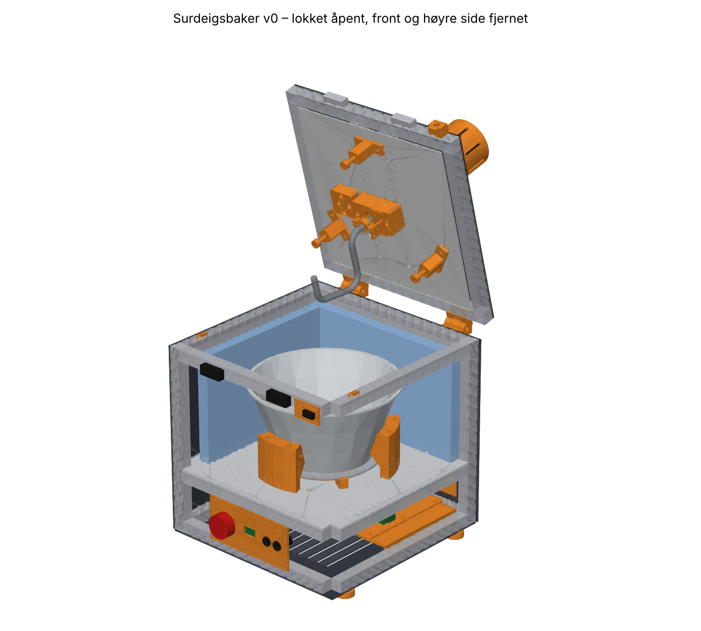

# Surdeigsbaker v0 – byggeveiledning

> **Status:** første utkast (v0.1, oktober 2026). Designet er laget og sjekket i CAD, men **ingenting er bygget ennå**. Du er den første som bygger det. Regn med at noe må justeres. Skriv ned avvik og legg dem inn som issues.

v0 er en benkemaskin som **blander, elter, holder temperaturen og bretter deigen under bulkhevingen**. Den måler hevingen og varsler deg når **deigen er klar for forming** ([ADR-007](../../docs/beslutninger/ADR-007-ingen-kjoling.md)). Etter det tar du over: du former, setter kurven i ditt eget kjøleskap og steker i vanlig ovn ([ADR-006](../../docs/beslutninger/ADR-006-steking-i-vanlig-ovn.md)).

Du veier og heller i ingrediensene selv (nivå N2). Automatisk dosering av levain og vann er flyttet til en v1-modul (se [§ 10](#10-kjente-begrensninger-og-neste-steg)). Designvalgene er begrunnet i [ADR-008](../../docs/beslutninger/ADR-008-v0-design.md).

| | |
|---|---|
| Mål | 346 × 346 mm. **541 mm** høy med lukket lokk, **ca. 700 mm** når lokket står åpent. |
| Bolle | Rustfri, ca. 3,5 l, avtakbar. Opptil ca. 1 kg deig. |
| Elting | 24 V planetgirmotor, 60–100 o/min, rustfri C-krok |
| Varme | 50 W silikonelement under en aluminiumsplate. Deigen holdes på 22–28 °C. |
| Strøm | **Bare 24 V inne i maskinen.** En CE-merket bordstrømforsyning på 150 W gjør om fra 230 V. |
| Styring | ESP32-S3 med ESPHome, nettside, Home Assistant og varsler på mobilen (ntfy) |
| Sikkerhet | Lokkbryter og nødstopp bryter motoren i maskinvaren. Termostat og termosikring på varmeplaten. |
| Pris | **Ca. 9 000 kr** i deler ([stykkliste](stykkliste.csv)), pluss frakt |

## Innhold

1. [Filene](#1-filene)
2. [Mål delene dine før du printer](#2-mål-delene-dine-før-du-printer)
3. [Kjøp](#3-kjøp)
4. [Print](#4-print)
5. [Kapp, bor og bøy](#5-kapp-bor-og-bøy)
6. [Montering](#6-montering)
7. [Idriftsetting](#7-idriftsetting)
8. [En vanlig bakedag med v0](#8-en-vanlig-bakedag-med-v0)
9. [Sikkerhet og hygiene](#9-sikkerhet-og-hygiene)
10. [Kjente begrensninger og neste steg](#10-kjente-begrensninger-og-neste-steg)

## 1. Filene

| Fil eller mappe | Innhold |
|---|---|
| [`../spec/v0.yaml`](../spec/v0.yaml) | **Alle mål.** Endre her og bygg på nytt. |
| [`printliste.md`](printliste.md) | 26 printede deler (pluss én valgfri) med antall, materiale og printretning |
| [`stl/`](stl/) | STL-filer, allerede snudd til printretning |
| [`step/`](step/) | STEP-filer per del og hele maskinen (`montasje.step`) for FreeCAD, Fusion og lignende |
| [`dxf/`](dxf/) | Kappefiler for de 8 platene og aluminiumsplaten. Oversikt: [`tegninger/plater_oversikt.png`](tegninger/plater_oversikt.png) |
| [`tegninger/krok_boyemal.svg`](tegninger/krok_boyemal.svg) | Bøyemal for kroken i 1:1 |
| [`stykkliste.csv`](stykkliste.csv) | Alt som skal kjøpes, med spesifikasjon, søkeord og omtrentlig pris |
| [`koblingsskjema.md`](koblingsskjema.md) | 24 V-fordeling, sikkerhetskjede og pinnekart |
| [`sjekkrapport.md`](sjekkrapport.md) | Automatiske kontroller: printvolum, klaring for kroken, lokket som åpnes, effekt |
| [`bilder/`](bilder/) | Gjengivelser av maskinen |
| [`../../firmware/v0/`](../../firmware/v0/) | ESPHome-fastvaren |
| [`../cad/`](../cad/) | Python-koden (build123d) som lager alt over |

Alt i `stl/`, `step/`, `dxf/`, `tegninger/`, `bilder/`, `printliste.md` og `sjekkrapport.md` lages av `python hardware/cad/bygg.py`. **Rediger aldri disse filene for hånd.** Se [`../cad/README.md`](../cad/README.md).

## 2. Mål delene dine før du printer

CAD-modellen bruker typiske mål for de kjøpte delene. De er merket ⚠️ i [`spec/v0.yaml`](../spec/v0.yaml). Kjøp delene først, mål dem, oppdater spec-fila og bygg på nytt før du printer delene som avhenger av dem.

| Mål dette | Med | Oppdater i `v0.yaml` | Påvirker |
|---|---|---|---|
| **Bollen:** diameter ved kanten, bunndiameter, høyde og godstykkelse | skyvelære og linjal | `bolle:` | bollestøttene, kroken, kantputene, fastvaren (`bowl_*`) |
| **Motoren:** kroppsdiameter, lengde, akseldiameter, pilotkrage. Hullsirkel for flenskruene hvis du vil bruke dem. | skyvelære | `motor:` | motorklemme, motorplate, motordeksel, koblingen |
| **OLED-modulen:** avstand mellom festehullene | skyvelære | `kontrollpanel.oled_hull` | kontrollpanelet |
| **ToF-modulen:** kretskortets bredde og høyde | skyvelære | `sensorhus.tof_kort` | sensorhuset |
| **DC-panelkontakten:** gjengediameter | skyvelære | `bakpanel.dc_hull_d` | bakpanelinnsatsen |
| **Mikrobryteren:** hullavstand og -diameter | skyvelære | `mikrobryter:` | bryterholderen |
| **Fjærene:** ytre diameter og fri lengde | skyvelære | `kantpress:` | kantputene |

Etter hver endring: kjør `python hardware/cad/bygg.py` og les [`sjekkrapport.md`](sjekkrapport.md). Alle deler skal passe på printeren, og kroken skal ha minst 5 mm klaring til bollen.

**Bollen er viktigst.** En ekte bolle har avrundet overgang mellom bunn og vegg, mens modellen regner den som en rett kjegle. Sett kroken i bollen og sjekk klaringen før du bøyer den ferdig (se [§ 5.3](#53-bøy-kroken)).

## 3. Kjøp

Alt står i [`stykkliste.csv`](stykkliste.csv) (åpnes i Excel, Numbers eller LibreOffice). Lenker står ikke der, fordi de blir fort utdaterte. Bruk søkeordene i kolonnen `sokeord`.

| Gruppe | Ca. pris |
|---|---|
| Ramme, plater og isolasjon | 2 400 kr |
| Bolle og varme | 700 kr |
| Drivverk (motor, kobling, lager, krokstang, fjærer) | 1 300 kr |
| Elektronikk | 2 200 kr |
| Kabler og kontakter | 700 kr |
| Skruer og muttere | 850 kr |
| Filament | 700 kr |
| **Sum** | **ca. 8 900 kr** |

**Bestill dette først**, fordi det tar lengst tid og fordi du må måle det før du printer:

1. Bollen (kjøp den i butikk, så du kan måle før du kjøper)
2. Motoren og silikonvarmeelementet (ofte 2–4 uker fra Kina)
3. Platene i ACM. Send DXF-filene til en skiltmaker eller CNC-tjeneste.

**Strømforsyningen er den eneste delen med 230 V.** Kjøp en CE-merket bordmodell fra en seriøs forhandler, ikke den billigste på markedsplassen.

Du trenger også verktøy: 3D-printer (minst 250 × 210 × 220 mm), loddebolt, multimeter, krympetang for endehylser, bor (3,4 / 5,5 mm), unbrakonøkler, skrustikke og et rør til å bøye kroken med (se bøyemalen).

## 4. Print

Følg [`printliste.md`](printliste.md). Kortversjon:

- **PETG**, 0,2 mm lag, 4 perimetre, 30–40 % gyroid. **Bærende deler** (lagerhus, motorplate, motorklemme og hengsler): 5 perimetre og 40 % fyll.
- **TPU 95A** bare til de tre tuppene på kantputene.
- Ca. **1,1 kg PETG**. Totalt 4–5 døgn printetid på en vanlig printer.
- **Print lagerhuset først** og sjekk at lagrene kan presses inn med en skrustikke. Er det for trangt eller for løst, juster `lagerhus.lager_ytre_d` (±0,1 mm) og print på nytt.
- Print bollestøttene etter at du har målt bollen.
- **Ingen printede deler er i kontakt med deigen.** Bollen og kroken er av rustfritt stål.

Varmeinnsatser (M3 × 5,7) settes inn med loddebolt i lagerhuset (2) og plateholderne (6).

## 5. Kapp, bor og bøy

### 5.1 Aluminiumsprofiler

Bestill dem ferdig kappet: **12 × 300 mm** og **4 × 320 mm** til rammen, og **2 × 340 mm** og **4 × 300 mm** til lokket. Endene må være rette og like lange (±0,3 mm), ellers blir rammen skjev.

### 5.2 Plater

Filene i [`dxf/`](dxf/) er i mm og skala 1:1. Det er 8 plater i ACM 3 mm og én rund aluminiumsplate (⌀ 180 × 3 mm). Se [`tegninger/plater_oversikt.png`](tegninger/plater_oversikt.png).

- **Enklest:** Send DXF-filene til en skiltmaker eller CNC-tjeneste.
- **Selv:** Skriv ut platene i 1:1 (del opp i A4-ark), lim dem på platen, kapp med stikksag og bor hullene.

### 5.3 Bøy kroken

Kroken er en C-krok av rustfri rundstang ⌀ 10 mm. Utbrettet lengde er 313 mm. **Kapp stanga til 350 mm.**

1. Skriv ut [`tegninger/krok_boyemal.svg`](tegninger/krok_boyemal.svg) i **100 %** og kontroller at 50 mm-streken er 50 mm.
2. Bøy rundt et rør med ytre ⌀ 30 mm (bøyeradius 20 mm til senter av stanga). Spenn røret i skrustikka og bøy for hånd med en rørforlengelse. Legg stanga på malen etter hver bøy.
3. Sjekk mot bollen: Hold stanga loddrett i senter og drei den rundt. Den skal ha **minst 5 mm** klaring til vegg og bunn hele veien.
4. Slip en **flate** (ca. 1 mm dyp, 15 mm lang) på toppen av stanga der settskruen i koblingen skal ta.
5. Puss bort grader og skarpe kanter. Vask stanga godt.

Ser kroken ut til å bli for stor eller liten for bollen din? Endre `krok:` i spec-fila, bygg på nytt og skriv ut en ny mal.

## 6. Montering

Bildene i [`bilder/`](bilder/) og [`step/montasje.step`](step/montasje.step) viser hvor alt sitter. Koordinatene i CAD: x mot høyre, y bakover (mot hengselen), z oppover.

### 6.1 Ramme

1. Legg 4 profiler på 300 mm i et kvadrat rundt de 4 stolpene (320 mm). Bruk hjørnevinkler med M5 × 10 og T-mutter. Gjør det samme på **tre nivåer**: bunn (z 0–20), midt (z 90–110) og topp (z 300–320).
2. Rett opp rammen: Diagonalene skal være like lange (±1 mm). Stram til.
3. Skyv inn ekstra T-muttere der platene, hengslene, bryterholderen og kabelklemmene skal sitte, **før** du setter på platene. Det er mye enklere nå enn senere.

### 6.2 Bunn og elektronikk

1. Fest **føttene** under bunnplata med M5 × 16 senkhode og lim på gummiputene. Skru bunnplata til den nederste rammen.
2. Skru **plateholderne** (venstre og høyre) innvendig på sidene av den nederste rammen. Legg **elektronikkplaten** på dem og skru den fast med M3 i varmeinnsatsene.
3. Monter modulene på elektronikkplaten med nylonavstandsstykker eller strips gjennom slissene:
   - **Bak til høyre**, nær DC-kontakten: sikringsboks og de to reléene
   - **I midten:** BTS7960, INA226 og kondensatoren på 1000 µF
   - **Foran:** hovedkortet med ESP32, buck-omformeren og D4184
4. Sett **kontrollpanelet** inn fra innsiden av frontplata. Monter nødstopp, knapper, LED og OLED i det.
5. Sett **bakpanelinnsatsen** inn i bakplata med DC-kontakten, USB-slissen og gummigjennomføringen.
6. Monter **romfølerhuset** med SHT40 på utsiden av bakplata, i de to M3-hullene på motsatt side av bakpanelinnsatsen. Ledningene går inn gjennom hullet på 6 mm mellom dem. Føleren må sitte utenfor kammeret.

### 6.3 Gulv, varmeplate og bollestøtter

1. Legg **gulvplata** på den midterste rammen og skru den fast.
2. Skru **varmeplateholderen** (stjerna med tre armer) til gulvplata med 3 × M3.
3. Klistre **varmeelementet** under aluminiumsplata. Lim **korkplata** under elementet.
4. Skru **KSD301** mot undersiden av aluminiumsplata med 2 × M3 senkhode i de to hullene ved kanten (24 mm avstand). Klem **termosikringen** mot platen ved siden av med kapton-tape. Bruk varmeledende pasta på begge. **Krymp** tilkoblingene til termosikringen, ikke lodd dem. Lodding kan utløse den.
5. Fest DS18B20-føleren for platen mot undersiden av aluminiumsplata (klemme eller kapton-tape med varmeledende pasta).
6. Legg aluminiumsplata i holderen. Ledningene går i sporene i armene og ned gjennom hullet i gulvet.
7. Trykk **silikonsnor** ⌀ 3 mm i sporet på de tre bollestøttene. Skru dem til gulvet med M3 (to per støtte).
8. Skyv DS18B20-føleren for bollen inn i kanalen i **bollestøtten med føler** (den foran). Tuppen skal ligge mot bolleveggen.
9. Sett bollen ned. Den skal stå rett på aluminiumsplata og være låst sideveis av de tre støttene uten å vippe.

### 6.4 Sider og isolasjon

1. Skru på side-, front- og bakplatene (M5 × 10 i T-mutterne).
2. Kapp **XPS** i 20 mm til de fire veggene i kammeret (fra gulvet til toppen av rammen). Den skal sitte i klem innenfor rammen.
3. Ledningene fra varmeplata og bollestøtten går ned gjennom gulvet til elektronikken.

### 6.5 Lokket

Bygg lokket med **foringen** (nederste plate) først og **topplata** sist. Mutterne for kantputene og sensorhuset sitter mellom de to platene.

1. Bygg lokkrammen: 2 × 340 mm foran og bak, 2 × 300 mm på sidene, og **2 × 300 mm tverrbjelker** ved x = ±30 mm.
2. **Foringen:**
   - Skru de tre **kantputene** under foringen (M5 × 16 med mutter på oversiden). Legg fjæren i huset, deretter stempelet, og trykk TPU-tuppen på stempelet.
   - Skru **sensorhuset** under foringen (M5 × 25 med mutter på oversiden). ToF-modulen og MLX90614 settes inn fra oversiden.
   - Skru foringen til lokkrammen.
3. **Lagerhuset:** Press inn de to lagrene, ett fra hver side. Skru lagerhuset under foringen med 2 × M5 × 30 opp i T-muttere i tverrbjelkene.
4. **Sensorarmen** skrus i varmeinnsatsene under lagerhuset. Fest gaffelsensoren på den.
5. **Topplata** skrus på lokkrammen.
6. **Motoren:**
   - Hvis du bruker flenskruene: Skru motoren til motorplaten nedenfra før platen festes.
   - Skru motorplaten på topplata med M5 × 25 ned i tverrbjelkene.
   - Legg 1 mm gummi rundt motorkroppen og sett på **motorklemmen**. Skru flensen til motorplaten (M5 × 35) og stram klemmeskruene (M5 × 25 med mutter).
7. **Kroken:** Stikk stanga opp gjennom foringen og lagrene. Sett på **hjemmeflagget** (klem med M3) rett under lagerhuset, slik at flagget går gjennom gaffelsensoren. Sett på **koblingen** og stram settskruene mot flaten på stanga og motorakselen.
8. Drei kroken for hånd. Den skal gå lett, uten slark.
9. Sett på **motordekselet**.

### 6.6 Lokket på rammen

1. Skru **hengslene** på bakkanten av rammen og lokket (M5). Hengselbolt M6 × 45 med låsemutter. Stram til så lokket går lett, men uten slark.
2. Trykk de to **styrekilene** i sporet på toppen av sideprofilene foran. De styrer lokket på plass og tar opp sidekreftene når kroken elter.
3. Skru **bryterholderen** med mikrobryteren på fronten oppe til høyre og **bryternesa** på fronten av lokket. Juster slik at bryteren klikker når lokket er 2–3 mm fra lukket.
4. **Stramlåsene:** Plasser de to låsene foran, ca. 70 mm fra senter på hver side. Merk og bor gjennom frontplata (5,5 mm), og skru dem fast med M5 i T-muttere i den øverste frontprofilen. Kroken på låsen skrus i lokkprofilen. **Låsene er nødvendige.** Kantputene presser lokket opp med ca. 120 N.
5. Åpne lokket. Hengselen stopper det ved ca. 104°.

### 6.7 Kabling

Følg [`koblingsskjema.md`](koblingsskjema.md). Viktigst:

- 24 V og motor i 0,75–1,0 mm² silikonledning. Signaler i 0,14–0,25 mm².
- Lokkabelen går ut gjennom gummigjennomføringen i bakpanelinnsatsen, opp baksiden og inn i lokket ved hengselen. Lag en **slakk sløyfe** ved hengselen og bruk spiralslange.
- Endehylser på alle flertrådede ledere i skrueterminaler.
- Fest ledningene med kabelklemmene i profilsporene. Ingen ledninger skal kunne komme borti kroken eller varmeplata.

## 7. Idriftsetting

Gjør dette i rekkefølge. **Ikke hopp over trinn**, og ikke la maskinen gå uten tilsyn før alle trinnene er gjort.

### 7.1 Uten strøm

- [ ] Drei kroken for hånd med bollen på plass. Minst 5 mm klaring hele veien.
- [ ] Parker kroken (C-en mot hengselen). Åpne og lukk lokket sakte. Kroken og kantputene skal ikke treffe bollen.
- [ ] Lukk lokket og lås det. Bollen skal sitte fast og ikke kunne vris for hånd.
- [ ] Test KSD301: Varm den med en hårføner mens du måler med multimeter. Den skal bryte ved ca. 60 °C og forbli brutt til du trykker på reset-knappen.

### 7.2 Strøm uten motor og varme

Koble fra motoren (M+ / M−) og varmeelementet.

- [ ] Mål motstanden mellom 24 V og GND: mer enn 1 kΩ.
- [ ] Sett buck-omformeren til **5,0 V** før ESP32-en kobles til.
- [ ] Lokket lukket og nødstoppen ute: K1 og K2 trekker (du hører et klikk), og det er 24 V på BTS7960 B+.
- [ ] Åpne lokket: K1 slipper, og B+ blir 0 V. K2 trekker fortsatt.
- [ ] Trykk inn nødstoppen: begge slipper.

### 7.3 Fastvare

- [ ] Last opp fastvaren og fyll inn DS18B20-adressene. Se [`firmware/v0/README.md`](../../firmware/v0/README.md).
- [ ] På nettsiden: Alle sensorene viser fornuftige verdier. *Lokket er lukket* og *Nødstopp ute* stemmer med virkeligheten.

### 7.4 Varme

Koble til varmeelementet. Fyll bollen med 1 l vann.

- [ ] Sett *Deigtemperatur* til 26 °C og varm opp. Platen skal aldri gå over *Maks platetemperatur* (38 °C).
- [ ] Kjør *Autotune varme* og legg inn PID-verdiene.
- [ ] Trekk ut DS18B20-føleren for platen mens varmen står på. Varmen skal slå seg av med én gang.

### 7.5 Motor

Koble til motoren. Start **uten bolle**.

- [ ] *Krok (bare for test)* på 20 %: Kroken går rolig, og C-en skyver nedover. Hvis ikke, bytt M+ og M−.
- [ ] Trykk *Pause* (knapp B): Kroken parkerer med C-en mot hengselen.
- [ ] Mens kroken går: Åpne lokket litt. **Motoren skal stoppe med én gang.** Lukk lokket. Den skal ikke starte igjen før du trykker **Start**.
- [ ] Mens kroken går: Trykk inn nødstoppen. Alt stopper, og LED-en blir rød.
- [ ] Kalibrer ToF-sensoren med tom bolle (*Kalibrer: tom bolle*).

### 7.6 E17: Eltetest (gjør dette tidlig!)

Den største usikkerheten i v0 er om en C-krok i senter av en kjegleformet bolle **faktisk elter** deigen, eller om deigen bare går rundt som en ball med kroken.

1. Lag en testdeig uten surdeig: 500 g hvetemel, 380 g vann og 10 g salt.
2. Kjør *Start deig* med *Fermentolyse* satt til 0 min og *Vent på saltlake* av. Se på hele eltingen.
3. Noter: Blir deigen glatt og elastisk (vindusprøven)? Henger den rundt kroken? Klatrer den opp? Vrir bollen seg? Hva er motorstrømmen?
4. Prøv 30 %, 50 % og 70 % fart.

Fungerer det dårlig, prøv i denne rekkefølgen: høyere fart, kortere intervall mellom retningsskift, en spiralkrok i stedet for C-krok, eller en krok som står litt ut fra senter. Skriv resultatet inn i [`docs/05-eksperimenter.md`](../../docs/05-eksperimenter.md) (E17).

### 7.7 Første brød

Når E17 er godkjent: Bak etter [referanseoppskriften](../../oppskrifter/referanse-v7.md) med prosessen i [`oppskrifter/maskinvennlig-v0.yaml`](../../oppskrifter/maskinvennlig-v0.yaml). Før logg i [`docs/maler/bakelogg.md`](../../docs/maler/bakelogg.md). Sammenlign med et brød laget for hånd samme dag.

## 8. En vanlig bakedag med v0

**Eksempel:** Du står opp kl. 07, er ute hele dagen og vil steke et brød neste morgen.

v0 kan ikke starte deigen om morgenen og passe den mens du er borte. Den har ingen utsatt start og ingen kjøling, og når bulkhevingen er ferdig, må deigen formes innen ca. 1 time (E16). Derfor bruker du **dagen til levainen**, **kvelden til deigen** og **natta til kjøleskapet**.

Mengdene er fra [`oppskrifter/maskinvennlig-v0.yaml`](../../oppskrifter/maskinvennlig-v0.yaml). De er foreløpige til referansebrødet (E01) er bakt og veid. Tidene er anslag.

| Tid | Du gjør | Maskinen gjør | Din tid |
|---|---|---|---|
| **07:00** | Lag levainen rett i maskinbollen: **10 g surdeig**, 40 g siktet mel, 10 g sammalt mel og 50 g vann (ca. 22 °C). Rør med en skje, sett bollen i maskinen og lukk lokket. | Ingenting. Den kan stå avslått. | 5 min |
| 07:30–17:30 | Du er ute. | Levainen modnes ved romtemperatur. | – |
| **17:30** | Sjekk at levainen er boblete og hevet. Hell i 460 g siktet mel, 100 g sammalt mel og 372 g vann (ca. 27 °C). Bland saltlaken i en kopp: 12 g salt og 48 g vann. Lukk og lås lokket, og trykk **Start**. | Blander i 3 min, deretter fermentolyse i 40 min ved 26 °C. | 10 min |
| **ca. 18:15** | Maskinen piper: *«Tilsett saltlaken.»* Åpne lokket, hell i saltlaken, lukk og lås, og trykk **Start**. | Elter i 10 min. | 2 min |
| 18:25–ca. 22:00 | Fri kveld. Hold mobilen eller ørene i nærheten. | Holder 26 °C, bretter deigen fire ganger (hver halvtime) og måler hevingen. | – |
| **ca. 22:00** | Varsel: *«Deigen er klar for forming.»* Ta ut bollen og tipp deigen ut på benken. Forform, la den hvile 20 min og gi den endelig form. Legg den i en melet hevekurv med klede over og sett den i kjøleskapet. Trykk **Start** for å kvittere. Skyll bollen og kroken. | Slår av varmen når deigen er klar. Minner deg på etter 1 time hvis du ikke har kvittert. | 20–30 min |
| Natta | Du sover. | – (deigen kaldhever i kjøleskapet, 8–24 t er greit) | – |
| **07:00** | Sett jerngryta med lokk i ovnen og forvarm til 260 °C. Vent minst 10 min etter at ovnen har nådd temperaturen. | – | 2 min |
| **ca. 07:50** | Strø litt helkorn i gryta, tipp den kalde deigen i og snitt. Stek 20 min ved 250 °C med lokk, deretter 25 min ved 200 °C uten lokk. | – | 5 min |
| **ca. 08:40** | Ta ut brødet. Kjernen skal være minst 96 °C. La det avkjøles på rist i 1–2 timer. | – | – |

Det blir ca. 45–60 minutter med aktivt arbeid, fordelt på fem korte økter. Bare levainen skjer om morgenen.

**Mindre surdeig i levainen:** Oppskriften bruker 20 g surdeig. Med 10 g bruker levainen hele dagen (ca. 10–12 timer ved 20–22 °C) i stedet for å bli overmoden før du kommer hjem. Det er en tommelfingerregel som E02 skal tallfeste.

### Hvis tidene ikke passer

- **Bulken blir for sen:** Sett *Bulkheving maks (t)* til 4 på nettsiden. Da er deigen klar senest ca. kl. 22:30, selv om den ikke har hevet seg helt. Litt for kort bulk er bedre enn at du har lagt deg. Du kan også sette *Bulkheving temperatur* til 27 °C.
- **Du kommer senere hjem enn 17:30:** Bruk enda mindre surdeig i levainen (5 g), eller sett bollen et kjøligere sted om morgenen.
- **Du vil slippe å være til stede for saltlaken:** Slå av *Vent på saltlake* og ha saltet i sammen med resten kl. 17:30. Det avviker litt fra oppskriften, men gjør kvelden enklere.
- **Husk å trekke maskinen fram** fra overskapene før du åpner lokket. Lyser LED-en blått (den arbeider), trykker du **Pause** først, så parkerer kroken.

### De første gangene

- Bli i nærheten mens maskinen elter, til eltetesten (E17) er gjort og du stoler på maskinen.
- Levainprogrammet i maskinen (hold **Start** inne i 2 s) holder temperaturen mens du er ute. Vent med å bruke det til du har bakt flere brød (se [§ 9](#9-sikkerhet-og-hygiene)). Programmet styres uansett mest av tid i v0, fordi ToF-sensoren knapt ser en så tynn levain i bunnen av bollen.
- Skriv i [bakeloggen](../../docs/maler/bakelogg.md) når levainen var klar og hvor lenge bulken varte. Det er de tallene en senere tidsplanlegger trenger for å treffe tiden for deg.

## 9. Sikkerhet og hygiene

- **Strøm:** Bare 24 V (SELV) i maskinen. Åpne aldri strømforsyningen. Bruk riktige sikringer (1, 2, 3 og 5 A).
- **Klemfare:** Lokkbryteren og nødstoppen bryter motoren i maskinvaren. Ikke koble dem forbi, heller ikke under testing. Kroken er treg, men sterk (flere N·m).
- **Varme:** Platen holdes ≤ 38 °C av fastvaren. KSD301 bryter ved 60 °C, termosikringen ved 77 °C. PETG mykner rundt 80 °C.
- **Tilsyn:** Ikke la maskinen gå uten tilsyn før du har bakt flere brød og stoler på den. Ikke la den gå mens du sover eller er borte de første gangene.
- **Matkontakt:** Bare bollen (rustfri), kroken (rustfri 316/304) og silikonsnoren berører deigen. Vask bollen og kroken etter hver bruk. Kroken kan tas av ved å løsne settskruen i koblingen.
- **Lagrene** sitter over bollen. Bruk tettede lager med matgodkjent fett.
- Fullstendig risikovurdering: [`docs/06-sikkerhet.md`](../../docs/06-sikkerhet.md).

## 10. Kjente begrensninger og neste steg

**Kjente begrensninger i v0:**

- **Høyden:** 541 mm med lukket lokk passer under de fleste overskap, men med åpent lokk trenger maskinen ca. 700 mm. **Trekk den fram før du åpner lokket**, som med en kjøkkenmaskin.
- **Eltingen er ikke testet** (E17). En C-krok i senter er valgt fordi den er enkel å lage og rengjøre.
- **Bollen holdes på plass av friksjon** (silikonsnor) og kantputene. Vrir den seg likevel, trenger vi en medbringer i bunnen.
- **Hevingen måles på ett punkt** med ToF-sensoren. Det er grovt.
- **Ingen tidsplanlegging ennå.** Fastvaren kan ikke regne baklengs fra «klar for forming kl. 20». Det kommer med fermenteringsmodellen fra E02.
- **Ingen kjøling** (ADR-007). Etter «klar for forming» venter deigen ved romtemperatur til du tar den ut.
- **Hovedkortet er hullkort.** Et ordentlig kretskort kommer i v1.

**Planlagt for v1:**

- **Doseringsmodul:** melbeholder med snegle og vekt, og pumper for vann og saltlake. Den ble tatt ut av v0 fordi den ikke fikk plass, og fordi helleretningen kolliderte med kroken.
- Tidsplanlegger som treffer et valgt tidspunkt for forming. Hvordan en bakedag blir da, står i [`docs/11-bruksscenarier.md`](../../docs/11-bruksscenarier.md).
- Kretskort (KiCad) i stedet for hullkort.
- VL53L1X eller kamera for bedre måling av hevingen.
- Lavere maskin, kanskje med motoren ved siden av bollen og en vinkelgir.
