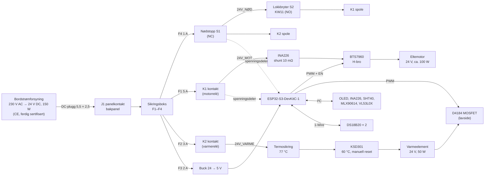

# Koblingsskjema – Surdeigsbaker v0

> **Status:** første utkast (v0.1). Ikke bygget eller testet ennå. Sjekk hver kobling mot databladet til *dine* moduler før du setter på strøm.

Maskinen går **bare på 24 V likestrøm (SELV)**. All 230 V er inne i en ferdig, CE-merket bordstrømforsyning. Du skal aldri åpne den eller føre 230 V inn i maskinen.

## Oversikt

## Sikkerhetsprinsipp

| Fare | Vern i maskinvare (virker uten fastvare) | Vern i fastvare |
|---|---|---|
| Hånd i bollen mens kroken går | **Lokkbryteren S2** forsyner spolen til motorreléet K1. Lokket åpnes → K1 slipper → motoren mister strømmen. | Ser at 24V_MOT forsvinner, slår av motorpådraget og krever trykk på **Start** før motoren går igjen. |
| Noe går galt, du vil stoppe alt | **Nødstoppen S1** bryter spolestrømmen til både K1 (motor) og K2 (varme). | Ser at 24V_NØD forsvinner, avbryter programmet og varsler. |
| Varmeplaten blir for varm | **KSD301** (60 °C, manuell reset) og **termosikring** (77 °C, engangs) i serie med elementet | Platen holdes ≤ 45 °C. Varmen slås av hvis en føler mangler, og mens motoren går. |
| Motoren låser seg | Sikring F1 (5 A) | INA226 måler strømmen. Over 4 A i mer enn 2 s → motoren stopper, og du får et varsel. |
| Kortslutning | Sikring per kurs (F1–F4) og strømbegrensningen i strømforsyningen | – |

Nødstoppen og lokkbryteren bryter **bare spolestrøm** (ca. 0,1 A per relé). Det er reléene som bryter motor- og varmestrømmen. Da blir ikke kontaktene i bryterne slitt av lysbuer fra motoren.

## Strømkurser (24 V)

| Kurs | Sikring | Fra → til | Last | Ledning |
|---|---|---|---|---|
| Inn | (strømforsyningens eget vern) | J1 → sikringsboks | maks 6,25 A | 1,0 mm² (AWG 18) |
| F1 motor | 5 A blad | sikringsboks → K1 (30) → K1 (87) → INA226 VIN+ → VIN− → BTS7960 B+ | ≤ 4 A kontinuerlig | 1,0 mm² |
| Retur motor | – | BTS7960 B− → GND-skinne | | 1,0 mm² |
| Motorledning | – | BTS7960 M+ / M− → motor (gjennom lokkabelen) | | 2 × 0,75 mm² silikon |
| F2 varme | 3 A blad | sikringsboks → K2 (30) → K2 (87) → D4184 VIN+ / OUT+ → termosikring → KSD301 → element → D4184 OUT− | 2,1 A | 0,75 mm² |
| F3 logikk | 2 A blad | sikringsboks → buck IN+ | ca. 0,3 A | 0,5 mm² |
| F4 styrestrøm | 1 A blad | sikringsboks → S1 nødstopp (NC) → **24V_NØD** → S2 lokkbryter (COM→NO) → K1 (86) ; 24V_NØD → K2 (86) ; K1/K2 (85) → GND | ca. 0,2 A | 0,5 mm² |

**Ekstra komponenter på 24 V-siden:**

- **D1, D2:** 1N4007 over spolen på K1 og K2 (katode mot +). Hopp over dem hvis reléet har innebygd diode, og sjekk da polariteten (85/86).
- **C1:** 1000 µF / 35 V elektrolytt mellom B+ og B− rett ved BTS7960.
- **TVS1:** P6KE33A (enveis) mellom B+ (katode) og B− rett ved BTS7960. Den tar spenningstoppen når K1 slipper mens motoren går.
- **GND-skinne:** Én felles stjernejord på elektronikkplaten (Wago 221-5 eller jordskinne). Alle 24 V-returer, buck GND og ESP32 GND samles her.

## Signaler og pinnekart (ESP32-S3-DevKitC-1)

Alle signaler er 3,3 V. Bruk **aldri** GPIO 0, 3, 45 og 46 (oppstartspinner), 19 og 20 (USB) eller 26–37 (flash/PSRAM).

| GPIO | Funksjon | Kobles til | Merknad |
|---|---|---|---|
| 8 | I²C SDA | OLED, INA226, SHT40, MLX90614, VL53L0X | Bussen kjøres i 50 kHz på grunn av lokkabelen. 4,7 kΩ pull-up til 3V3 (fjern ekstra pull-ups på modulene hvis det blir mer enn tre). |
| 9 | I²C SCL | samme | |
| 4 | 1-Wire | DS18B20 bollevegg + DS18B20 varmeplate | 4,7 kΩ pull-up til 3V3 |
| 5 | Motor RPWM (framover) | BTS7960 RPWM | 20 kHz PWM |
| 6 | Motor LPWM (bakover) | BTS7960 LPWM | 20 kHz PWM |
| 7 | Motor EN | BTS7960 R_EN **og** L_EN | Lav = begge halvbroene av |
| 15 | Varme PWM | D4184 PWM/TRIG | Langsom PWM, 5 s periode |
| 18 | Status-LED | APA106 DIN (via 330 Ω) | Se *Status-LED* under |
| 17 | Summer | passiv piezo via 100 Ω | Valgfri, men anbefalt |
| 10 | Knapp A «Start/OK» | knapp → GND | Intern pull-up |
| 11 | Knapp B «Pause/Stopp» | knapp → GND | Intern pull-up. Hold inne 3 s = avbryt. |
| 12 | Måling 24V_MOT | spenningsdeler 75 kΩ / 10 kΩ + 100 nF | Høy = lokket lukket, nødstopp ute og K1 trukket |
| 13 | Måling 24V_NØD | spenningsdeler 75 kΩ / 10 kΩ + 100 nF | Lav = nødstopp trykket inn |
| 14 | Hjemmesensor | optisk gaffelsensor, signal | Flagget på krokakselen bryter lyset når C-en peker mot hengselen |

Spenningsdeleren gir 2,8 V ved 24 V og 3,1 V ved 26,4 V (øverste justering på mange strømforsyninger). Bruk 1 %-motstander.

### I²C-adresser

| Enhet | Adresse | Plass |
|---|---|---|
| SSD1306 OLED 0,96" | 0x3C | kontrollpanelet |
| INA226 | 0x40 | elektronikkplaten |
| SHT40 | 0x44 | romfølerhuset på baksiden |
| MLX90614 | 0x5A | sensorhuset under lokket |
| VL53L0X | 0x29 | sensorhuset under lokket |

### Forsyning til moduler

| Modul | Forsyning | Merknad |
|---|---|---|
| ESP32-S3-DevKitC-1 | 5 V fra buck til **5V**-pinnen | Ikke koble til USB og 24 V samtidig første gang. Flash første gang med 24 V frakoblet, deretter over WiFi (OTA). |
| BTS7960 (IBT-2) logikk | **3V3** til VCC | Bufferen på kortet (74HC244) tåler da 3,3 V-signalene trygt. R_IS og L_IS kobles ikke til. |
| D4184 | – | Styres direkte med 3,3 V |
| OLED, INA226, SHT40, MLX90614, VL53L0X, DS18B20, gaffelsensor | 3V3 | Til sammen under 100 mA |
| APA106 | 5 V **gjennom en diode** (1N4148) | Dioden senker forsyningen til ca. 4,3 V. Da er 3,3 V-data nok. |

**Buck-omformeren må stilles til 5,0 V før den kobles til ESP32.** Mål med multimeter. Bruker du en fast 5 V-modul, slipper du dette.

### INA226-shunten

INA226-modulene leveres med 0,1 Ω shunt (R100), som bare måler opptil 0,8 A. **Bytt den til 10 mΩ (R010, 2512, ≥ 1 W).** Da måler den opptil 8,2 A. Fastvaren er satt opp for 0,010 Ω.

## Lokkabelen

Lokket har motor, sensorhus og hjemmesensor. Kabelen går fra elektronikkplaten, ut gjennom gjennomføringen i bakpanelinnsatsen, opp baksiden og inn i lokket ved hengselen.

| Leder | Signal | Tverrsnitt |
|---|---|---|
| 1–2 | Motor M+ / M− | 0,75 mm² silikon |
| 3 | 3V3 | 0,14–0,25 mm² |
| 4 | GND | 0,14–0,25 mm² |
| 5 | SDA | tvinn med GND |
| 6 | SCL | tvinn med GND |
| 7 | Hjemmesensor | 0,14–0,25 mm² |

- Bruk **myk silikonkabel** og lag en slakk sløyfe ved hengselen. Kabelen bøyes ca. 100° hver gang lokket åpnes.
- Hold motorlederne unna I²C-lederne. Tvinn motorlederne sammen.
- Bruk JST-XH- eller Dupont-kontakter med låsing på signalene, slik at lokket kan tas av.

## Rekkefølge ved første oppstart

Følg idriftsettingen i [`README.md`](README.md#7-idriftsetting). Kortversjon:

1. Mål motstanden mellom 24 V og GND før strøm (> 1 kΩ).
2. Sett buck-omformeren til 5,0 V uten ESP32 tilkoblet.
3. Sett på strøm uten motor og uten varmeelement. Sjekk at K1 trekker når lokket lukkes og slipper når det åpnes, og at nødstoppen slipper begge reléene.
4. Flash fastvaren over USB med 24 V frakoblet. Deretter kan du kjøre med 24 V og oppdatere over WiFi.
5. Test varmen med elementet først, motoren til slutt.
