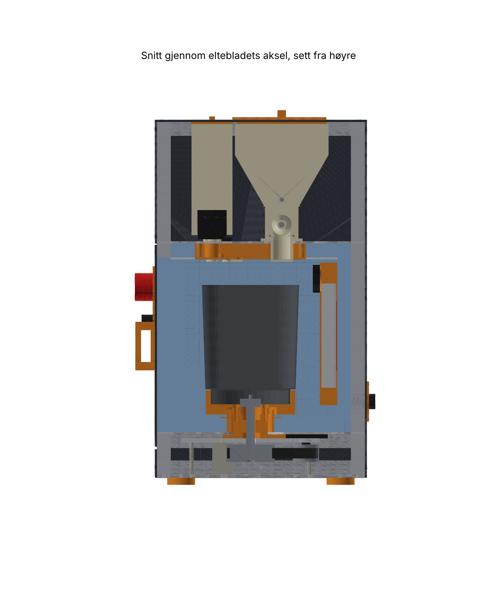
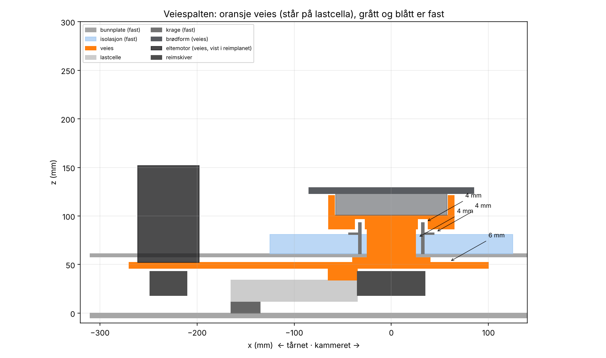
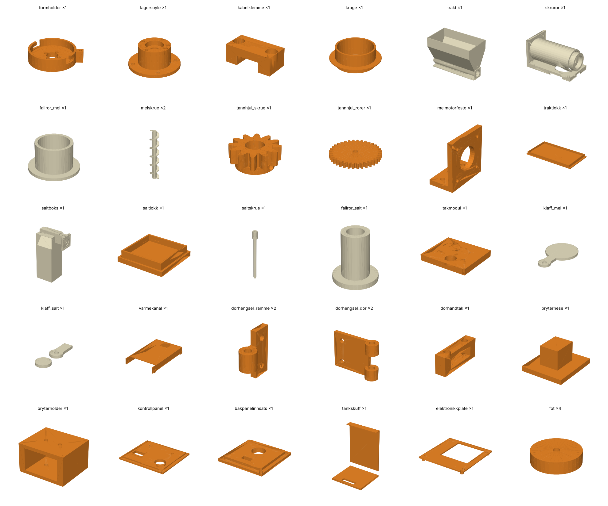

# Surdeigsbaker v1 – byggeveiledning

> **Status:** første utkast (v1.0, oktober 2026). Designet er laget og sjekket i CAD, og fastvaren er testet i simulering. **Ingenting er bygget ennå.** Regn med at noe må justeres. Skriv ned avvik og legg dem inn som issues.

v1 er en benkemaskin som **doserer mel, vann og salt selv, bygger levainen av surdeigen du legger i, elter, bretter og holder deigen varm**. Den planlegger baklengs fra tiden du velger, og varsler når **deigen er klar for forming**. Etter det tar du over: du former, setter kurven i kjøleskapet og steker i vanlig ovn ([ADR-006](../../docs/beslutninger/ADR-006-steking-i-vanlig-ovn.md), [ADR-007](../../docs/beslutninger/ADR-007-ingen-kjoling.md)).

Designvalgene er begrunnet i [ADR-010](../../docs/beslutninger/ADR-010-v1-arkitektur.md). v0 i [`../v0/`](../v0/README.md) bygges ikke.

| | |
|---|---|
| Mål | **481 × 306 × 526 mm** (b × d × h med føtter). Med håndtak og hengsler: 492 × 334 × 540 mm. |
| Deig | Ca. 1 kg: 560 g mel, ca. 77 % vann, 2 % salt |
| Elting | Brødmaskinform fra Panasonic XL (SD-2500/2501/ZB2502) med eget drivverk: 24 V girmotor på 120 W og reim 2:1 |
| Vekt | Hele drivverket med formen står på én lastcelle på 10 kg (NAU7802). Maskinen veier surdeigen og alt den doserer. |
| Mel | Ca. 1,5 kg i beholderen. Vannrett skrue på 28 mm med røreverk og klaff. |
| Salt | Ca. 450 g i en tett boks. Skrue på 10 mm og egen klaff. |
| Vann | 1 l tank i tårnet, fylles per baking. Peristaltisk pumpe som går baklengs etter dosering. |
| Varme | 60 W silikonmatte på en kjøleprofil bak formen, med vifte. Deigen holdes på 16–28 °C. |
| Måling | ToF-sensor (heving), IR-termometer (overflaten), føler mot formbunnen, kammerluft. Kamera (Pi Zero 2 W, [ADR-009](../../docs/beslutninger/ADR-009-kamera.md)). |
| Strøm | **Bare 24 V inne i maskinen.** Mean Well GST220A24 (221 W, CE) gjør om fra 230 V. |
| Styring | ESP32-S3 med ESPHome ([fastvaren](../../firmware/v1/README.md)), nettside, Home Assistant og varsler på mobilen (ntfy) |
| Sikkerhet | Dørbryteren og nødstoppen bryter motoren i maskinvaren. Termostat og termosikring i varmekretsen. Strømgrense i motordriveren. |
| Pris | **Ca. 17 800 kr** i deler ([stykkliste](stykkliste.csv)), pluss frakt og en brukt brødmaskin |

## Innhold

1. [Filene](#1-filene)
2. [Slik er maskinen bygget](#2-slik-er-maskinen-bygget)
3. [Skaff en giver og mål delene](#3-skaff-en-giver-og-mål-delene)
4. [Kjøp](#4-kjøp)
5. [Print](#5-print)
6. [Kapp, bor og forbered](#6-kapp-bor-og-forbered)
7. [Montering](#7-montering)
8. [Idriftsetting](#8-idriftsetting)
9. [En bakedag med v1](#9-en-bakedag-med-v1)
10. [Sikkerhet og hygiene](#10-sikkerhet-og-hygiene)
11. [Kjente begrensninger og neste steg](#11-kjente-begrensninger-og-neste-steg)

## 1. Filene

Alt her er generert av [`hardware/cad/v1/bygg.py`](../cad/v1/) fra [`hardware/spec/v1.yaml`](../spec/v1.yaml). Ikke rediger STL-, STEP- eller DXF-filene for hånd. Endre spec-fila og bygg på nytt.

| Fil eller mappe | Innhold |
|---|---|
| [`stl/`](stl/) | 30 printede deler, snudd til printretning |
| [`step/`](step/) | De samme delene som STEP, og hele maskinen i `montasje.step` |
| [`dxf/`](dxf/) | Skjærefiler: 8 ACM-plater, takforingen og 4 aluminiumsplater (bunnplate, mellomgulv, topplate og plattform) |
| [`printliste.md`](printliste.md) | Antall, materiale, printretning og merknader |
| [`stykkliste.csv`](stykkliste.csv) | Alt du må kjøpe, med søkeord og forslag til butikk |
| [`koblingsskjema.md`](koblingsskjema.md) | Strøm, sikkerhetskjede, pinnekart og kablene over veiespalten |
| [`sjekkrapport.md`](sjekkrapport.md) | Kontrollene i CAD: printstørrelse, veiespalten, uttak av formen, dørsving, beholdere, deigen i formen, effekt |
| [`bilder/`](bilder/) | Bilder av maskinen, snitt og veiespalten |
| [`tegninger/plater_oversikt.png`](tegninger/plater_oversikt.png) | Oversikt over alle platene |

## 2. Slik er maskinen bygget

- **Kammeret** (til høyre) er isolert med 20 mm XPS. Brødformen står i en printet holder midt i kammeret.
  - Bak formen sitter en kanal med kjøleprofil, varmematte og vifte.
  - Taket er en printet **takmodul** med fallrørene for mel og salt, vanndysen, ToF-sensoren, IR-termometeret, kameraet og lyset.
  - Kammeret har dør foran. Isolasjonspluggen i døra er skåret 2,7 mm skrått på venstre kant, ellers ville den tatt borti isolasjonen når døra svinger.
- **Tårnet** (til venstre) har vanntanken i en skuff foran, pumpa, eltemotoren og elektronikken. Kontrollpanelet sitter på fronten.
- **Toppen** har melbeholderen over hele bredden, saltboksen foran den og motorene til skruene.
  - Melskruen trekker melet mot høyre til fallrøret over formen.
  - Begge utløpene har klaffer i taket, som bare er åpne under dosering. Da kommer ikke fuktig luft fra kammeret inn i melet.
- **Vekta:** Under mellomgulvet ligger en **plattform** av 6 mm aluminium på én lastcelle. Den bærer lagersøylen med akselen og formholderen, reimdriften og eltemotoren.
  - Ingenting annet berører dette. Spalten rundt er minst 4 mm, og kablene henger i en myk sløyfe.
  - Derfor veier maskinen nøyaktig alt den doserer.

## 3. Skaff en giver og mål delene

Målene i spec-fila er typiske mål. **Mål dine egne deler og oppdater [`hardware/spec/v1.yaml`](../spec/v1.yaml) før du printer.** Verdiene merket ⚠️ i fila må alltid sjekkes.

1. **Kjøp en brukt Panasonic SD-2500, SD-2501 eller SD-ZB2502** på Finn.no (180–500 kr). Helst to like: én til referanse og én til å ta fra hverandre.
2. **Bak et brød med maskinens eget deigprogram** og 560 g mel, ca. 77 % vann. Se at eltebladet får med seg alt melet. Det er grunnlaget for E17 (se [eksperimentene](../../docs/05-eksperimenter.md)).
3. **Mål formen** (spec-nøkkel `form:`): utvendig ved kanten og bunnen, høyde, hjørneradius, foten (diameter og høyde) og knastene (bredde og utstikk). Mål også hvor mange grader formen dreies for å låses (`formholder.knast_vinkel`).
4. **Ta ut koblingsdelen** («base connector») under formen i maskinen. Mål boringen og høyden (`koblingsdel:`). Akselen på 12 mm må passe i den, eller du lager en overgang.
5. **Mål eltemotoren, lastcella, pumpa og vanntanken** når du har dem (`eltemotor:`, `lastcelle:`, `vann:`).
6. Kjør `python hardware/cad/v1/bygg.py`. Sjekk at [`sjekkrapport.md`](sjekkrapport.md) fortsatt er grønn, særlig veiespalten (≥ 3 mm) og uttaket av formen.

## 4. Kjøp

Hele lista med antall, spesifikasjon og søkeord står i [`stykkliste.csv`](stykkliste.csv). Grovt:

| Gruppe | Ca. kr |
|---|---|
| Ramme, plater og isolasjon | 4 600 |
| Form og drivverk (giver, girmotor, reim, aksel, lastcelle) | 3 000 |
| Dosering (steppere, aksler, lager, servoer, pumpe, tank) | 2 300 |
| Varme | 700 |
| Elektronikk (strømforsyning, ESP32-S3, drivere, sensorer, releer) | 4 800 |
| Kamera | 900 |
| Festemidler og filament | 1 500 |
| **Sum** | **ca. 17 800** |

**Bestill tidlig:**

- Girmotor, lastcelle og strømforsyning (2–4 uker).
- Aluminiumsplatene: send DXF-filene til en CNC- eller vannskjæringstjeneste.

Strømforsyningen er den eneste delen med 230 V. Kjøp den fra en seriøs forhandler (RS, Mouser, DigiKey eller Electrokit).

## 5. Print

Følg [`printliste.md`](printliste.md). Totalt ca. 1,2 kg PETG.

- **Deler som berører mel eller salt** (trakt, skruror, fallrør, skruer, saltboks og klaffer):
  - Print i naturfarget PETG med samsvarserklæring etter EU 10/2011, med dyse av rustfritt stål.
  - Bruk 3 perimetre og glatte ytterflater.
  - Ingen printede deler berører deigen.
- **Formholderen og lagersøylen** bærer formen og eltemomentet. Print med 6 perimetre og 50 % fyll. Prøv formen i holderen før du går videre: den skal låses med en liten vridning og løsne lett.
- **Melbeholderen** (`trakt`) er 249 × 145 × 169 mm og fyller nesten hele platen på en Prusa MK4. Print den stående, slik den er modellert. Skråveggene er 60°, så den trenger ikke støtte.

## 6. Kapp, bor og forbered

**Profiler:** Bestill ferdig kappet (R1). Endene må være rette.

**Plater:**

- ACM-platene og aluminiumsplatene kappes og bores etter DXF-filene.
- Bunnplata (5 mm) får 4 gjengede M6-hull for overlaststoppene. Hullene er 5,0 mm i DXF-en.
- Motorhullene i plattformen er spor, slik at reima kan strammes.

**XPS:**

- Kapp gulv, sider, bakvegg og tak etter [`montasje.step`](step/montasje.step). Lag hull i gulvet til kragen (⌀ 68).
- Dørpluggen er 2 lag à 20 mm. **Skjær venstre kant skrått, 2,7 mm innover på innsiden.**
- Lag en lomme i fronten av venstre isolasjonsvegg til dørbryteren.

**Aksler:**

| Aksel | Kapp til | Forbered |
|---|---|---|
| 8 mm (melskrue) | ca. 335 mm | Slip en flate på 0,5 mm langs hele akselen |
| 12 mm (elteblad) | ca. 105 mm | Lag flater for settskruene |
| 6 mm (røreverk) | ca. 255 mm | Bor 9 hull på ⌀ 3 mm tvers gjennom med 25 mm mellomrom, dreid 45° for hvert hull. Lim inn pinner av 3 mm rustfri tråd, 32 mm lange. |

## 7. Montering

### 7.1 Ramme og bunnplate

1. Skru sammen rammen med hjørnevinkler. Den har fire ringer, fire hjørnestolper og to stolper i skilleveggen.
2. Skru rammen fast på bunnplata.
3. Sett på føttene.

### 7.2 Lastcelle og plattform

1. Skru den faste enden av lastcella på bunnplata med en avstandskloss på 12 mm. Pila på cella skal peke nedover.
2. Skru plattformen på den andre enden med en kloss på 12 mm.
3. Skru inn de 4 overlaststoppene (M6) i bunnplata. Still dem til **0,3 mm under plattformen** med følelermål, og lås med mutter.
4. Monter NAU7802-kortet på bunnplata ved cella. Bruk korte, tvunnede ledninger.

### 7.3 Drivverket

1. Press de to 6001-2RS-lagrene inn i lagersøylen, ett fra hver side. Sett inn 4 varmeinnsatser (M5) på toppen.
2. Skru lagersøylen til plattformen.
3. Sett akselen gjennom med reimskiva (40 tenner) under plattformen og settringer. Akselen skal gå lett, uten aksialt slark.
4. Monter koblingsdelen fra giveren på toppen av akselen.
5. Skru formholderen på lagersøylen. Legg DS18B20-føleren med fjær i lomma og kabelen gjennom kanalen.
6. Skru eltemotoren på plattformen med reimskiva (20 tenner) under. Legg på reima HTD 610-5M-15. Stram ved å skyve motoren i sporene, og skru fast.
7. Legg kablene fra motoren og føleren i kabelklemma på plattformen.

### 7.4 Mellomgulv, krage og kammer

1. Legg mellomgulvet på ringen. Sjekk at lagersøylen og motoren går fri av hullene.
2. Legg XPS-gulvet i kammeret og lim kragen i hullet.
3. **Sjekk veiespalten:** Formholderens skjørt skal gå fritt over kragen. Spalten er ca. 4 mm rundt og over. Trykk lett på holderen og se at vekta reagerer. Slipp, og se at den går tilbake.
4. Sett inn sider, bakvegg og skillevegg med isolasjon.
5. Lim varmematta på baksiden av kjøleprofilen. Skru KSD301, termosikringen og DS18B20 mot profilen.
6. Skru varmekanalen over profilen og mot bakveggen. Skru vifta foran åpningen øverst.

### 7.5 Tårnet

1. Sett inn tankskuffen. Den skal gli inn og ut, og fronten skal lukke luka.
2. Skru pumpa mot skilleveggen og koble slangene. Bruk sugerør og hurtigkobling til tanken, og dyserør til takmodulen.
3. Skru elektronikkplata og bærekortet på venstre side i tårnet (se [koblingsskjemaet](koblingsskjema.md)).
4. Monter kontrollpanelet og bakpanelinnsatsen med panelkontakten.

### 7.6 Tak, beholdere og fallrør

1. Legg XPS-taket og takforingen, og skru topplata på ringen under taket.
2. Sett fallrørene for mel og salt ned i hullene i topplata.
3. Sett inn takmodulen nedenfra med ToF-sensoren, MLX90614, SHT40, kameraet, lyset og de to servoene. Skru den til topplata. Sett klaffene på servoarmene.
4. Tre melskruen på akselen. Tre akselen gjennom 608-lageret i venstre ende av beholderen, beholderen og utløpsrøret, og ut gjennom lageret i høyre ende.
5. Monter tannhjulene og røreverket i venstre ende.
6. Tett skjøten mellom beholderen og utløpsrøret med næringsmiddelgodkjent silikon. Skru delene på topplata.
7. Monter melmotoren med koblingen.
8. Sett saltskruen i saltboksen og skru på pannekakestepperen. Skru boksen på topplata.
9. Sett Pi Zero 2 W på topplata og koble kamerakabelen gjennom slissen.

### 7.7 Dør og sider

1. Skru dørhengslene på høyre side og døra på hengslene (M6 × 45).
2. Lim bryterneset på innsiden av døra, og dørbryteren i holderen i isolasjonen.
3. Sett på dørpakningen, magneten i håndtaket og stålskiva på stolpen.
4. Skru på sideplatene, bakplata og topplata med åpningene for mel og salt.

### 7.8 Kabling

Følg [`koblingsskjema.md`](koblingsskjema.md). Viktigst er dette:

- **Veiesløyfa:** Kablene fra plattformen (motor, Hall-teller og deigføler) henger i én slakk sløyfe på ca. 150 mm til tårnveggen. De skal ikke berøre noe på veien.
- **Kabelen til takmodulen:** I²C-buss B, servoene og 5 V. Hold den unna motorledningene.
- **Sikkerhetskjeden:** sikring F5 → nødstoppen → dørbryteren → spolen til K1. Nødstoppen forsyner også K3 og, gjennom KSD301, K2.

## 8. Idriftsetting

### 8.1 Uten strøm

1. Mål motstanden mellom 24 V og GND (> 1 kΩ).
2. Drei eltebladet for hånd. Det skal gå lett, og reima skal ikke slure.
3. Sjekk at klaffene, skruene og røreverket går fritt.

### 8.2 Strøm uten motorer og varme

Koble fra eltemotoren, pumpa, stepperne og varmematta.

1. Mål buck-omformerne (5,0 V).
2. Sjekk at K1 trekker når døra lukkes og slipper når den åpnes.
3. Sjekk at nødstoppen slipper alle tre reléene.

### 8.3 Fastvare

Se [`firmware/v1/README.md`](../../firmware/v1/README.md). Flash over USB første gang, med 24 V frakoblet. Skriv inn adressene til de tre DS18B20-følerne fra loggen.

### 8.4 Vekta

1. Les NAU7802-rådata uten noe på plattformen og med et kjent lodd, f.eks. 1 000 g. Skriv inn tallene i `substitutions`.
2. Sett inn den tomme formen og trykk **Lagre tom form**.
3. **Test veiespalten:** Legg et lodd på 100 g i formen. Vekta skal vise 100 ± 0,5 g, også når du flytter litt på kabelsløyfa og lukker døra. Viser den mindre, berører noe plattformen.

### 8.5 ToF og klaffer

1. Les avstanden fra ToF-sensoren med tom form og skriv den inn som `tof_to_bottom`.
2. Juster `flap_open` og `flap_closed` til klaffene ligger tett under fallrørene og svinger helt fri.

### 8.6 Dosering (E11 og E12)

1. Fyll mel, salt og vann. Dosér 3 × 200 g mel, 3 × 10 g salt og 3 × 300 g vann rett i formen.
2. Vei på en kjøkkenvekt etterpå.
3. Noter feilen, tiden og om melet danner bro.

### 8.7 Varme (E13)

1. Fyll formen med ca. 1 kg vann og kjør PID-autotune for **Varme**.
2. Skriv inn verdiene.
3. Sjekk at kjøleribba holder seg under 38 °C, og at deigføleren følger vanntemperaturen.

### 8.8 Elting (E17)

1. Kjør en hel deig uten levain: vann, mel, fermentolyse, salt og elting.
2. Se at eltebladet får med seg melet i hjørnene, og at deigen blir glatt.
3. Følg med på motorstrømmen. Den bør ligge under ca. 6 A.

### 8.9 Første brød

Start med god tid til målet, f.eks. 12–14 t. Følg med på nettsiden. Etter et par bakinger har maskinen lært surdeigen din.

## 9. En bakedag med v1

Eksempel: Du står opp kl. 07, skal ut hele dagen og vil forme brødet når du kommer hjem. Tidene er fra simuleringen i [`firmware/v1/test/bake_test.cpp`](../../firmware/v1/test/bake_test.cpp) med 20 g kald surdeig og 21 °C i rommet.

| Tid | Du | Maskinen |
|---|---|---|
| 06:55 | Fyller vanntanken. Sjekker at det er mel og salt. Legger 1 ss surdeig (ca. 20 g) rett fra kjøleskapet i formen og setter den inn. | |
| 07:00 | Velger «klar kl. 18:00» og trykker **Start**. | Veier surdeigen: 20 g. Planlegger levain 1:2,5:2,5 og ca. 27 °C. Doserer 50 g vann og 50 g mel og blander. |
| 07:05 | Går. | Levainen hever og holdes varm. |
| 14:20 | | Levainen er klar. Doserer 326 g vann og 500 g mel i tre porsjoner og blander. |
| 14:30–15:10 | | Fermentolyse |
| 15:10 | | Doserer 11 g salt og 45 g vann og elter i 11 min |
| 15:30–16:30 | | Bretter tre ganger |
| 16:35 | | Tar nullpunkt for hevingen. Følger hevingen og justerer varmen. |
| ca. 18:00 | Får varsel på mobilen. Former og setter kurven i kjøleskapet. Trykker **Deigen er formet**. | Lagrer hvor aktiv surdeigen var, til neste gang. |
| Neste morgen | Steker i gryte i vanlig ovn ([ADR-006](../../docs/beslutninger/ADR-006-steking-i-vanlig-ovn.md)) | |

**Hvis tiden ikke går:** Med 1 ss kald surdeig er det tidligst ca. kl. 17:30, og maskinen sier fra hvis tiden er for tidlig.

- Vil du være klar kl. 17, bruk 2 ss (40 g), eller en surdeig du matet kvelden før.
- Senest er ca. kl. 08 neste morgen. Da utsetter maskinen starten og bruker mer levain-fortynning.

## 10. Sikkerhet og hygiene

- **Strøm:** Bare 24 V inne i maskinen. Strømforsyningen står utenfor.
- **Elting:** Motoren stopper når døra åpnes. Den starter ikke igjen før du trykker **Fortsett**.
- **Varme:** Platen holdes under 38 °C. KSD301 bryter ved 50 °C, og termosikringen ved 72 °C.
- **Vann:** Fyll vann per baking. Etter siste dosering pumper maskinen slangen tom baklengs. Vask tanken hver uke, og bytt pumpeslangen en gang i året.
- **Mel og salt:**
  - Børst og støvsug beholderen, skruen og trauet tørt hver uke. Er delene vasket, må de være helt tørre før du fyller igjen.
  - Bytt silikagel i saltlokket når den har skiftet farge.
- **Form og elteblad:** Vask for hånd, ikke i oppvaskmaskin.

## 11. Kjente begrensninger og neste steg

- **Melskruen (E11)** er den største usikkerheten. Ingen åpne prosjekter har vist at de kan dosere mel. Klarer ikke skruen det, er reserveplanen å legge forhåndsveid mel i beholderen og dosere alt på én gang (N2).
- **Formen og koblingen** er modellert etter typiske mål. Holderen og akselen må tilpasses giveren din.
- **Våt deig i brødmaskinform** (77 %) er ikke målt av andre. E17 viser om eltebladet klarer det.
- **Bretting med eltebladet** er ikke vist av andre (E05).
- **Tidspresisjonen ved første baking** med en ukjent surdeig er ca. ±1 t. Etter én baking er den bedre, fordi aktiviteten læres.
- **Høyden** (53 cm) passer ikke under alle overskap. Trekk maskinen fram for å fylle mel.
- **Kameraet** tar bilder, men styringen bruker dem ikke ennå ([ADR-009](../../docs/beslutninger/ADR-009-kamera.md), E18).
