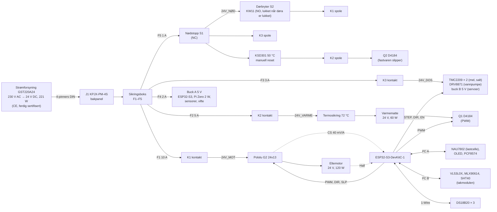

# Koblingsskjema – Surdeigsbaker v1

> **Status:** første utkast (v1.0). Ikke bygget eller testet ennå. Sjekk hver kobling mot databladet til *dine* moduler før du setter på strøm.

Maskinen går **bare på 24 V likestrøm (SELV)**. All 230 V er inne i en ferdig, CE-merket strømforsyning (Mean Well GST220A24-R7B). Du skal aldri åpne den eller føre 230 V inn i maskinen.

## Oversikt

## Sikkerhetsprinsipp

| Fare | Vern i maskinvare (virker uten fastvare) | Vern i fastvare |
|---|---|---|
| Hånd i formen mens eltebladet går | **Dørbryteren S2** forsyner spolen til motorreléet K1. Døra åpnes → K1 slipper → G2 mister strømmen. | Ser at døra er åpen (PCF8574 P1), stopper motoren og krever et trykk på knappen før den går igjen. |
| Du vil stoppe alt | **Nødstoppen S1** bryter spolestrømmen til K1 (motor), K2 (varme) og K3 (dosering). | Ser at 24V_NØD forsvinner (P2), avbryter programmet og varsler. |
| Varmen løper løpsk | **KSD301** (50 °C, manuell reset) bryter spolen til K2. **Termosikringen** (72 °C, engangs) sitter rett i varmekretsen. Begge er skrudd mot kjøleprofilen. | Profilen holdes ≤ 38 °C. Varmen slås av hvis en føler mangler. Q2 slipper K2 hvis Q1 skulle kortslutte. |
| Motoren låser seg | **Strømgrensen i G2** (stilles til ca. 8 A) og sikring F1 | Over 6 A i mer enn 2 s → motoren stopper, og du får et varsel. |
| Mel eller salt stopper ikke | K3 slipper med nødstoppen | Vekta skal øke. Øker den ikke, eller øker den for mye, stopper doseringen. |
| Kortslutning | Sikring per kurs (F1–F5) og overlastvernet i strømforsyningen | – |

Nødstoppen, dørbryteren og KSD301 bryter **bare spolestrøm** (ca. 0,1 A per relé). Det er reléene som bryter motor- og varmestrømmen. Da slites ikke bryterkontaktene av lysbuer, og KSD301 slipper å bryte likestrøm den ikke er laget for.

## Strømkurser (24 V)

| Kurs | Sikring | Fra → til | Last | Ledning |
|---|---|---|---|---|
| Inn | (strømforsyningens eget vern) | J1 → sikringsboks | maks 9,2 A | 1,5 mm² |
| F1 motor | 10 A blad | sikringsboks → K1 (30) → K1 (87) = **24V_MOT** → G2 VIN | ≤ 5 A, topp 8 A | 1,0 mm² |
| Motorledning | – | G2 OUTA / OUTB → eltemotor (gjennom veiesløyfa) | | 2 × 1,0 mm² silikon |
| F2 varme | 5 A blad | sikringsboks → K2 (30) → K2 (87) = **24V_VARME** → Q1 VIN+. Q1 OUT+ → termosikring → varmematte → Q1 OUT− | 2,5 A | 0,75 mm² |
| F3 dosering | 3 A blad | sikringsboks → K3 (30) → K3 (87) = **24V_DOS** → TMC2209 VM (× 2), DRV8871 VM, buck B IN | ca. 2 A | 0,75 mm² |
| F4 logikk | 2 A blad | sikringsboks → buck A IN, vifte (via Q3) | ca. 0,5 A | 0,5 mm² |
| F5 styrestrøm | 1 A blad | sikringsboks → S1 (NC) → **24V_NØD** → S2 (COM → NO) → K1 (86); 24V_NØD → K3 (86); 24V_NØD → KSD301 → K2 (86) → K2 (85) → Q2 OUT− ; K1/K3 (85) → GND | ca. 0,3 A | 0,5 mm² |

**Ekstra komponenter på 24 V-siden:**

- **D1–D3:** 1N4007 over spolene på K1, K2 og K3 (katode mot +). Hopp over dem hvis reléet har innebygd diode, og sjekk da polariteten (85/86).
- **C1, C2:** 1000 µF / 35 V elektrolytt ved G2 VIN og ved TMC2209-ene.
- **TVS1, TVS2:** P6KE33A (enveis) over G2 VIN og over 24V_DOS. De tar spenningstoppen når et relé slipper mens en motor går.
- **GND-skinne:** Én felles stjernejord på bærekortet. Alle 24 V-returer, buck-ene og ESP32 samles her.

## Signaler og pinnekart (ESP32-S3-DevKitC-1)

Alle signaler er 3,3 V. Bruk **aldri** GPIO 0, 3, 45 og 46 (oppstartspinner), 19 og 20 (USB), 26–37 (flash/PSRAM) eller 43 og 44 (seriell logg). GPIO 38 og 48 er ledige. Den innebygde RGB-dioden sitter på en av dem, avhengig av kortversjonen.

| GPIO | Funksjon | Kobles til | Merknad |
|---|---|---|---|
| 1 | Motorstrøm (ADC) | G2 CS | Ca. 40 mV/A (sjekk databladet for ditt kort). 10 kΩ + 100 nF lavpass. |
| 2 | Varme PWM | Q1 D4184 PWM | Langsom PWM, 2 s periode |
| 4 | Motor PWM | G2 PWM | 20 kHz (LEDC-kanal 0) |
| 5 | Motor retning | G2 DIR | |
| 6 | Motor på | G2 SLP | Lav = driveren sover. 10 kΩ pull-down, så motoren står ved oppstart. |
| 7 | Motorturteller | Hall A fra eltemotoren | Pulsteller (PCNT). 4,7 kΩ pull-up til 3V3. |
| 8 | I²C A SDA | NAU7802, OLED, PCF8574 | 100 kHz, 4,7 kΩ pull-up |
| 9 | I²C A SCL | samme | |
| 10 | Mel STEP | TMC2209 (mel) STEP | Pulser fra LEDC (kanal 2), frekvens = fart |
| 11 | Mel DIR | TMC2209 (mel) DIR | Melskruen går baklengs ved brodannelse |
| 12 | Salt STEP | TMC2209 (salt) STEP | LEDC (kanal 4). DIR på saltdriveren kobles fast (til GND eller 3V3, etter retningen). |
| 13 | Steppere på | TMC2209 EN (begge) | Lav = på. 10 kΩ pull-up, så stepperne er av ved oppstart. |
| 14 | 1-Wire | DS18B20 deig, kjøleprofil og rom | 4,7 kΩ pull-up til 3V3 |
| 15 | Pumpe IN1 | DRV8871 IN1 | IN1 høy = vann inn |
| 16 | Pumpe IN2 | DRV8871 IN2 | IN2 høy = baklengs (tømmer slangen) |
| 17 | I²C B SDA | VL53L0X, MLX90614, SHT40 | 50 kHz (MLX90614 tåler maks 100 kHz), 4,7 kΩ pull-up i takmodulen |
| 18 | I²C B SCL | samme | |
| 21 | Varmerelé på | Q2 D4184 PWM | Høy = K2 kan trekke (hvis nødstopp og KSD301 er OK) |
| 39 | Klaff mel | servo (mel), signal | 50 Hz (LEDC-kanal 6) |
| 40 | Klaff salt | servo (salt), signal | 50 Hz (LEDC-kanal 7) |
| 41 | Dreieknapp A | EC11 A | Intern pull-up |
| 42 | Dreieknapp B | EC11 B | Intern pull-up |
| 47 | Vifte | Q3 D4184 PWM | Av/på |

### PCF8574 (I²C A, adresse 0x20)

| Pinne | Funksjon | Merknad |
|---|---|---|
| P0 | Dreieknappens trykk | Knapp → GND |
| P1 | Døra lukket | Spenningsdeler 100 kΩ / 15 kΩ fra spolen til K1 (etter S2). Høy = døra lukket og nødstoppen ute. |
| P2 | Nødstopp ute | Spenningsdeler 100 kΩ / 15 kΩ fra 24V_NØD. Lav = nødstoppen er trykket inn. |
| P3 | Summer | Aktiv summer 5 V via NPN (BC547) |
| P4 | Grønn LED | Via 330 Ω til 3V3 (lav = på) |
| P5 | Rød LED | Via 330 Ω til 3V3 (lav = på) |
| P6 | Lokket på melbeholderen | Valgfri mikrobryter → GND |
| P7 | Ledig | |

Spenningsdeleren gir 3,1 V ved 24 V og 3,4 V ved 26,4 V (øverste justering på strømforsyningen). Bruk 1 %-motstander.

### I²C-adresser

| Buss | Enhet | Adresse | Plass |
|---|---|---|---|
| A | NAU7802 (vektforsterker) | 0x2A | på bunnplata ved lastcella |
| A | OLED 1,3" SH1106 | 0x3C | kontrollpanelet |
| A | PCF8574 | 0x20 | bærekortet |
| B | VL53L0X (heving) | 0x29 | takmodulen |
| B | MLX90614 (deigoverflate) | 0x5A | takmodulen |
| B | SHT40 (kammerluft) | 0x44 | takmodulen |

### 1-Wire

| Føler | Plass | Merknad |
|---|---|---|
| DS18B20 deig | I formholderen, med fjær mot formbunnen | Kabelen går gjennom kanalen i holderen og lagersøylen, så under plattformen og gjennom veiesløyfa |
| DS18B20 kjøleprofil | Skrudd mot kjøleprofilen, ved siden av KSD301 | Fastvaren holder profilen ≤ 38 °C |
| DS18B20 rom | I hullet i bakpanelinnsatsen, ute i rommet | Romtemperaturen går inn i tidsplanen |

### Forsyning til moduler

| Modul | Forsyning | Merknad |
|---|---|---|
| ESP32-S3-DevKitC-1 | 5 V fra buck A til **5V**-pinnen | Flash første gang over USB med 24 V frakoblet, deretter over WiFi (OTA). |
| Pi Zero 2 W | 5 V fra buck A til stiftlisten (pinne 2 og 6), 1000 µF ved Pi-en | Kameraet og lyset styres fra Pi-en ([ADR-009](../../docs/beslutninger/ADR-009-kamera.md)). |
| Pololu G2 | VIN = 24V_MOT. Logikken er 3,3 V-kompatibel. | **Still strømgrensen** (VREF-potmeteret) til ca. 8 A før første kjøring. |
| TMC2209 × 2 | VM = 24V_DOS, VIO = 3V3 | MS1 = MS2 = GND (1/8 mikrosteg, stealthChop). Still strømmen med potmeteret: ca. 1,2 A RMS (mel) og 0,6 A (salt). |
| DRV8871 | VM = 24V_DOS | Strømgrensen på kortet er ca. 2 A. Pumpen trekker ca. 0,4 A. |
| Servoer MG90S × 2 | 5 V fra buck B (på 24V_DOS) | Signalet fra ESP32 (3,3 V) er nok. |
| NAU7802, OLED, PCF8574, VL53L0X, MLX90614, SHT40, DS18B20 | 3V3 fra ESP32 | Til sammen under 100 mA |
| Vifte 24 V | F4 via Q3 | |

**Buck-omformerne må måles til 5,0 V før de kobles til noe.** Bruk faste 5 V-moduler (f.eks. Pololu D24V30F5), så slipper du å stille dem.

## Veiesløyfa (kabler over veiespalten)

Alt på plattformen veies. Hver kabel som går fra plattformen til resten av maskinen, kan bære litt av vekta og gi feil i doseringen. Derfor:

| Kabel | Ledere | Tverrsnitt |
|---|---|---|
| Eltemotor | 2 | 1,0 mm² silikon |
| Hall-teller | 3 (5 V eller 3V3, GND, A) | 0,25 mm² silikon |
| DS18B20 deig | 3 | 0,25 mm² silikon |

- Samle kablene i **kabelklemma** på plattformen (i motoråpningen i mellomgulvet).
- La dem henge i **én slakk sløyfe på ca. 150 mm** til veggen i tårnet. Sløyfa skal ikke berøre noe på veien.
- Bruk **myke silikonledninger**, ikke PVC-ledninger. De er stive og varierer med temperaturen.
- Sjekk etter montering: Legg et lodd på 100 g i formen. Vekta skal vise 100 ± 0,5 g, også når du flytter litt på sløyfa.

## Kabelen til takmodulen

Fra bærekortet i tårnet, opp gjennom en gjennomføring i topplata og bort til takmodulen.

| Leder | Signal | Tverrsnitt |
|---|---|---|
| 1 | 3V3 | 0,25 mm² |
| 2 | GND | 0,25 mm² |
| 3 | SDA (buss B) | tvinn med GND |
| 4 | SCL (buss B) | tvinn med GND |
| 5 | 5 V servo (buck B) | 0,5 mm² |
| 6 | GND servo | 0,5 mm² |
| 7 | Klaff mel (GPIO 39) | 0,25 mm² |
| 8 | Klaff salt (GPIO 40) | 0,25 mm² |

Kamerakabelen (FFC) går fra Pi-en på topplata gjennom slissen ved kameraet. Lyset for kameraet (2 hvite LED med 68 Ω fra 5 V, NPN fra Pi GPIO 17) får sin egen tynne kabel fra Pi-en.

## Rekkefølge ved første oppstart

Følg idriftsettingen i [`README.md`](README.md#8-idriftsetting). Kortversjon:

1. Mål motstanden mellom 24 V og GND før strøm (> 1 kΩ).
2. Mål buck-omformerne (5,0 V) uten noe tilkoblet.
3. Sett på strøm uten motorer, pumpe og varmematte. Sjekk at:
   - K1 trekker når døra lukkes og slipper når den åpnes.
   - Nødstoppen slipper alle tre reléene.
   - K2 bare trekker når fastvaren slår på Q2.
4. Flash fastvaren over USB med 24 V frakoblet. Deretter kan du kjøre med 24 V og oppdatere over WiFi.
5. Kalibrer vekta (se README), og test lastcella med veiesløyfa på plass.
6. Test varmen, så pumpen, så klaffene og skruene, og eltemotoren til slutt.
